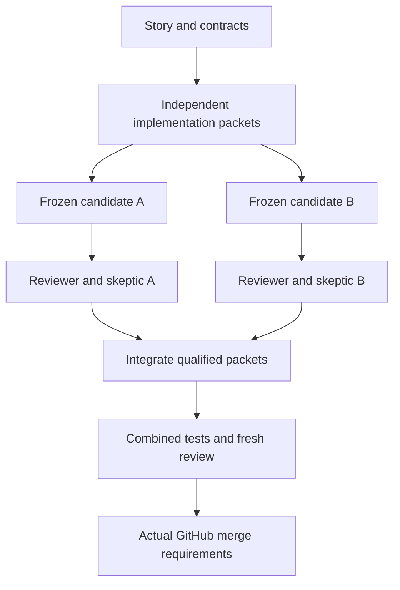

# Native swarm review across Foresight

Decision source: the user's 2026-11-03 request to make the shared skills and review process work with simultaneous agent swarms and native background/subagent capabilities.

## Outcome and scope

Use the active harness to coordinate independent implementation and review work. A fresh reviewer context and a separate skeptic context are the ordinary agent-review path. A complete review cycle, relevant deterministic checks and a final integrated-tree review qualify the work locally. Actual GitHub requirements still govern publication and merge.

The canonical operating skills are [UltraCode](https://github.com/riatzukiza/.agents/tree/main/skills/ultra-code) and [PR flow](https://github.com/riatzukiza/.agents/tree/main/skills/pr-flow). A source proposal is distinct from a deployed required-check adapter. This policy does not claim that a publisher, protection migration or host installation has occurred.

The audit covered all 127 current-main catalog SKILL.md files, current main/device branch differences in the skill catalog, root Foresight routing/policy, and targeted agent/review/workflow files in all 22 manifest child repositories plus OpenPlanner and River-City. Child default-branch trees reported no truncation. Open PR inspection was bounded to the first page of at most 100 per child; it is not an exhaustive review of every historical branch or issue. Branch-protection detail returned 403 through the connected integration, so configured workflows are not asserted to be the complete enforced gate set.

## Execution graph

Packet writers can run together when their inputs and write scopes permit it. Reviews can run while unrelated packets continue. A failed packet blocks its descendants, not the whole swarm. Merges into a shared target serialize through the existing branch policy or queue.

## Review unit and independence

Record the repository, baseline, candidate head/tree and any dirty/untracked source in an immutable snapshot manifest. Pin the prompts, role instructions, schemas, models, packet boundaries, gates and upstream artifacts. The native evidence checker hashes the exact EDN plan bytes.

A reviewer receives the task and source, not the implementer's conversation or desired verdict. A skeptic receives that exact reviewer artifact and the underlying source, tests each finding, and records confirmed, refuted with evidence, or uncertain. Each reviewer has a predeclared skeptic, even when the review may find nothing; this prevents a changing roster from invalidating earlier evidence.

A fresh context is sufficient for the workflow's independent reasoning role when actually created and given the proper input. It does not automatically create a different filesystem, operating-system principal, GitHub account or protected publisher. Use the harness's available read-only controls or snapshots and document any shared permission boundary. Never claim stronger isolation than observed.

Do not require all available brands to review every change or repeat a fixed number of review rounds. Select specialist lenses from the task's risks. Repair real findings, re-freeze the candidate, and repeat on new inputs. Bound repeated attempts within a wave; when a wave stalls, change the approach or preserve a concrete blocker while continuing independent work. Do not turn a wave budget into a lifetime cap or acceptance of unresolved work.

## Ownership

| Resource | Owner during a run |
| --- | --- |
| Story scope and dependency graph | Coordinator for that task or epic |
| Each PR or tightly coupled stack | One PR coordinator |
| Each branch/ref, lockfile, migration or shared output | One writer at a time |
| Read-only review lens | Fresh reviewer context |
| Finding challenge and coverage check | Separate skeptic context |
| Combined source tree | Integrator |
| Required GitHub check/review publication | Actual authorized producer |
| Card state | Rheos |
| Event semantics and admitted records | Clio and owning Receipt River adapters |
| Runtime dispatch | Active harness, or an explicitly selected Sol/Knoxx adapter |
| Staging/deployment | Existing Services owners and environment gates |

Independent PRs may have different coordinators. A global one-active-PR rule is inappropriate for this profile. Dependent stack layers still need their real prerequisites and a qualified integration base.

Do not make a new shared mutable board, journal service or scheduler merely to execute native subagents. Keep workflow manifests and immutable evidence alongside the existing owners. For coordination across different harnesses or hosts, use observed shared-resource claims and existing authorized infrastructure; a local file or a prompt label alone is not a distributed lock.

## Completion is explicit

The bounded native checker validates a frozen review roster and supplied receipts. It rejects missing jobs, incomplete scope, malformed output, failed gates, stale plan/snapshot/attempt bindings, contradictory task identifiers and incomplete skeptic coverage. Its reports distinguish clean, findings, incomplete, failed and stale. Supplied evidence validation does not authenticate the underlying execution.

A candidate is locally qualified only when its entire declared coverage completes, findings have valid dispositions, and relevant checks pass. Packet acceptance is insufficient for the combined change: run cross-package tests and fresh review of the final tree. A changed base or head requires the applicable integration/review evidence to be refreshed.

Keep author walkthroughs after synthesis and before requesting external review. Explain the outcome, why the changed behavior is appropriate, important alternatives, tests and limits. The walkthrough is author context, not independent approval.

## GitHub boundary

The native profile changes how agent review is performed. It does not fabricate native APPROVED events, grant access, waive actual required checks, clear unresolved conversations, or authorize a merge. Verify current required policy and the exact head/base before any authorized merge. If policy detail is inaccessible, preserve that limitation instead of inferring that no requirements exist.

The current pr-flow CLI still implements hosted-provider laws and cannot ingest native UltraCode receipts. Keep its original provider evidence and historical rounds intact. A required hosted publisher needs a reviewed adapter before it can turn validated native execution evidence into an attested check. The publisher must bind source, actual execution provenance, complete coverage, current head/base, final verdict, and revocation; candidate-controlled JSON alone cannot authorize its own green check.

Keep required check names until the actual protection is inspected and an authorized migration is verified. Proxx explicitly preserves a historical coderabbit-review-gate context. Do not remove it based on a name or a documentation change.

## Changes by surface

| Surface | Audit finding | Action |
| --- | --- | --- |
| riatzukiza/.agents | UltraCode mandates external BB/OpenCode execution; PR flow assumes provider cohorts and five-round convergence | Add native default, retain explicit legacy backend, provide bounded native evidence checker and distinct profile routing |
| Foresight root | Policy centers the provider roster and persistent review workers | Route native work to the new profile; retain deployment, staging and trusted-publisher obligations |
| Knoxx | Local skill/operator guidance selects one active stack PR and names both CodeRabbit/Codex | Clarify per-stack ownership and native review precedence in root policy and operator guide; preserve the OpenCode symlink |
| eta-mu and Muse | Reusable hosted workflow/worker contracts constrain model and delegation | Treat existing workers as optional leaf adapters; add native receipt ingestion only where a required publisher needs it |
| Sol, Knoxx, Axxium | Existing execution/status/auth ownership can support cross-host execution | Reuse these boundaries if durable jobs or trusted publication are needed; local native review does not wait for a new service |
| Clio and receipt-river | Durable evidence ownership already exists; segmented records are in flight | Reuse actual adopted envelopes/writers; retain immutable historical receipts; no invented admission |
| Proxx and Uxx | Provider checks and model identities are explicit | Preserve required contexts and executed-model evidence; migrate through actual protected policy |
| Other manifest children and adjacent projects | Shared reusable workflows and new Antigravity/Gemini review PRs are in flight | Adopt shared skill routing and keep local test/build gates; avoid another provider-specific policy fork |
| Device catalogs | Main, Stealth and Yoga differ; some workflow skills are absent from device snapshots | Reconcile selected accepted skill versions per host, preserving unrelated files and historical backups |

The remaining catalog touchpoints include pr-review-settlement, pr-review-to-merge, pr-sprint-planning, kanban-push-orchestration, kanban-ultra-wave-cadence, opencode-batch-subagent-dispatch, model-routing and opencode-agent-authoring. Read their domain-specific purpose before editing: the Truth lore actor's no-subagent rule, for example, is scoped to an archaeology method and is not a global PR policy.

## Independent rollout stories

| ID | User story and reason | Acceptance evidence | Dependencies |
| --- | --- | --- | --- |
| SWARM-1 | As a coordinator, use native agents across supported harnesses so concurrent work does not require a nested CLI runner | Native profile, observed capability record, fresh reviewer/skeptic results, parser and completeness regression tests | None |
| SWARM-2 | As a PR owner, let independent PRs progress together so one provider queue cannot stall unrelated work | Per-PR ownership, real dependency ordering, current snapshot checks, final integrated review | SWARM-1 contract |
| SWARM-3 | As a maintainer, accept native execution through any genuinely required hosted gate without losing source/identity evidence | Trusted collector/publisher fixtures: forged evidence, stale head/base, partial output, duplicate attempt, replay and revocation rejected; real required-policy readback | SWARM-1 evidence contract; actual repository gate inventory |
| SWARM-4 | As a multi-host operator, run the intended accepted skill version on each host so stale copies cannot reintroduce serial rules | Per-host catalog source/digest, capabilities, selective update/readback; no unrelated overwrites | SWARM-1 and relevant PR-flow changes accepted |
| SWARM-5 | As an integrator, combine concurrent packets safely so individually green branches cannot hide interface regressions | Conflict/ownership inventory, combined tests, fresh final-tree reviewer/skeptic evidence | Packet prerequisites only |

SWARM-1 and SWARM-2 guidance can be prepared together. SWARM-3 and SWARM-4 can proceed independently once their shared contract is settled. SWARM-5 runs for each integration, not after a global fleet migration.

Existing work to reconcile includes .agents #54 (provider inventory, stacked on #53), #57 (author walkthrough), #34 (segmented receipts) and #52 (host placement on device/stealth), plus the existing eta-mu/Muse review-runtime and fleet Antigravity/Gemini PRs. Keep these changes source-owned and avoid replacing their unrelated behavior.

## Capability references

Current primary documentation supports native delegation but versions differ. OpenCode v2 documents fresh child sessions, background completion and separate worktree tools. Claude Code documents fresh subagents and explicit worktree isolation. Codex documents inherited sandbox/approval policy. Discover the actual installed capability before selecting syntax.

- [OpenCode v2 agents](https://dev.opencode.ai/v2/docs/agents/)
- [OpenCode v2 tools](https://dev.opencode.ai/v2/docs/tools/)
- [Claude Code subagents](https://code.claude.com/docs/en/sub-agents)
- [Codex subagents](https://learn.chatgpt.com/docs/agent-configuration/subagents)

These links establish documented capabilities. They do not prove the version or settings on Stealth, Yoga, a deployed reviewer, or a future session.
