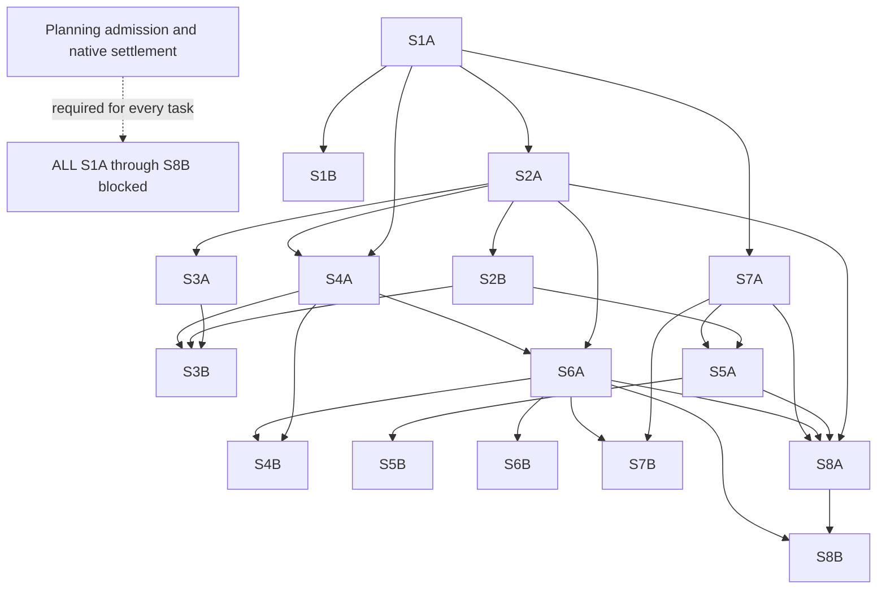

# Oikos execution plan: precise prerequisites, unchanged authority

2026-11-03. Planning proposal, not readiness or completion evidence.
License: GPL-3.0-or-later.

## Authority and current hold

Keep the existing [program narrative and epic index](oikos-local-first-workbench.md#epic-map)
as the entry point for the eight epics. This note describes execution of their
sixteen children, using the
[program manifest](../../.ημ/workflows/oikos-program.edn).
The manifest and this DAG are execution/review descriptions, **not canonical
Rheos authority**. All sixteen child vectors were subsequently synchronized
through Rheos and verified by official readbacks; the engine, not this note,
still owns admission, status and dependency transitions.
The coordinator must read live tasks before acting; saved card snapshots are
dated evidence, not a replacement board.

At the original `b9ac3141` checkpoint,
[planning PR #153](https://github.com/open-hax/foresight/pull/153) had sixteen
unsettled native threads and two body items. After publishing `51d80fad`, the
coordinator settled all sixteen threads and posted both itemized body replies;
native readback reported zero unresolved threads. Current-head review/convergence
and the receipt-history gate remain blocked. No
approval, ready transition, task completion or integration completion is asserted.
**All sixteen tasks are blocked by planning admission.** S1A alone has no proposed
task prerequisite; that does not make S1A ready or authorize implementation.

## Earlier planning checkpoint, before final dispositions

This checkpoint combines the coordinator's reported state with the persisted
[skeptic reconciliation](../../.ημ/runs/oikos-program-20261103/skeptics/reconciliation.edn),
read for this documentation update. Official board state is reported as **24
incoming / 0 done**; the documentation worker has not performed a new live Rheos
or native GitHub query.

All sixteen owned worktrees exist. Sixteen independent planning review reports
produced **53 candidate findings**. Both 53-ID skeptic passes are now persisted;
the reconciliation validates matching ID sets and classifies them as:

| Comparison classification | Count | Meaning at this checkpoint |
| --- | --- | --- |
| Consensus remaining | 12 | Acceptance-criteria corrections assigned to a separate worker; not yet verified complete |
| Consensus historically addressed | 14 | Agreement about prior planning corrections, not implementation proof |
| Consensus refuted | 4 | Agreement about candidate refutation, not task approval |
| Disputed | 23 | Adjudication pending; neither settled nor approved |

The 12 acceptance-criteria corrections are being applied separately. At this
documentation check, `consensus-fixes-v1.edn` was not found under the program run;
no completion of those corrections is claimed. Completion must not be reported
until that artifact exists and is read. Two persisted passes are not a completed
qualified review round, exact-head approval or settlement of all findings.
At this earlier checkpoint, PR #153's original sixteen threads and two body
items were still open. Their later native settlements are recorded below;
local review classification alone did not resolve native review state.

### S1A preparatory specification, not implementation

The coordinator reports an independent re-review of the preparatory S1A
specification found all three P2 findings fixed. The specification SHA-256 is
`8bed8627de1f3c4f79ff70f5156f8bbd854e0566e684fe9b1d7fc8fb54c125f0`.
It is committed privately as `92df993` on `feat/oikos-s1a`:
[pinned specification](https://github.com/open-hax/oikos/blob/92df993/docs/specs/s1a-generation-contracts.md).
The native private [Oikos PR #1](https://github.com/open-hax/oikos/pull/1) is
reported **OPEN**. This is preparatory specification evidence only: no task
implementation or planning admission is inferred. The parent Oikos gitlink must
not advance to this unmerged source merely because the specification was pushed.
The original architecture/smoke links below retain their original source pin.

### Separate receipt-buffer diagnosis

A separate diagnosis/planning branch, `fix/receipt-git-buffer-20261103`, has
commit `7a0d842` and an open stacked personal
[Foresight PR #52](https://github.com/riatzukiza/foresight/pull/52), as reported
by the coordinator. The actual `ENOBUFS` failure is unchanged. The diagnosed
cause is a **1 MiB** buffer cap against a roughly **1.28 MiB** ledger; the
historical prefix is safe. A finite **16 MiB** cap is proposed, **not implemented**.
Diagnosis, a planning commit and an open PR are not runtime repair evidence.

### Existing baseline only

The coordinator reports the current passing baseline below; these suites were
not rerun by the documentation worker and qualify no future acceptance criterion:

| Scope | Tests / assertions |
| --- | --- |
| Root project | 12 / 171 |
| Root workspace | 24 / 122 |
| Child BB | 5 / 37 |
| Child NBB | 8 / 59 |
| Child evaluation | 9 / 39 |
| Lint | 0 errors / 0 warnings |

Policy is unchanged. Per-task post-implementation adversarial code review and
fresh epic integration remain **future required work**, not merely dispatched
work being counted as complete. Planning reports, spec re-review and baseline
tests replace none of those gates; all tasks retain the planning-admission hold.

## Nine operator policy answers

These are bounded program policy decisions, not blanket execution permits:

1. Qualified program merges are authorized; qualification and native review
   settlement still apply. Authorization is not an approval record.
2. Deployment is sandbox/dev only, not installation or production promotion.
3. Personal capture and personal-data upload are held: use synthetic inputs only.
4. Retention is 24 hours for images and 7 days for text; deletion propagates to
   derived data. Accepted knowledge requires explicit consent, not automatic
   promotion of generated observations. A later per-task review clarified the
   accepted-payload rule through the question tool: consent must name an expiry
   or explicitly select indefinite retention for that item. Accepting a claim
   alone extends no deadline, and raw sources still expire. This decision is
   retained in `.ημ/runs/oikos-program-20261103/decisions/accepted-retention.edn`.
5. Autonomy covers agent-owned resources only. Operator-owned windows, buffers,
   resources and attention require explicit approval; joining remains deliberate.
6. Models use existing resources only. Download, load and restart actions remain
   held; this includes 12B experiments.
7. Cloud use is synthetic-only, through the actual `mojomast/govone` policy
   session, and only with verified no-charge admission. A supposedly free
   provider is not evidence of admission.
8. Paid spending is **0**; historical Colab budgets grant no inherited authority.
   Real remote tool publication/account setup, including ChatGPT, remains held.
9. Dependency precision may replace whole-epic waits with verified specific child
   artifacts. This does not weaken effect, governance or planning gates.

## Sources and privacy

Oikos is private. These source links are pinned to
`ae35073719974c0df1d2dae301c2179fa4785641`; access is required, and an
unauthenticated 404 is not proof that a private artifact is absent:

- [Workbench architecture](https://github.com/open-hax/oikos/blob/ae35073719974c0df1d2dae301c2179fa4785641/docs/architecture/workbench.md).
- [Measured synthetic perception smoke](https://github.com/open-hax/oikos/blob/ae35073719974c0df1d2dae301c2179fa4785641/docs/research/perception-smoke-2026-11-03.md).

Do not turn private child paths into relative GitHub links through the public
Foresight submodule directory. Source privacy does not authorize capture data,
credentials or runtime state in Git.

## Isolated ownership and task-key dictionary

Each child owns a distinct Oikos branch/worktree, not a shared checkout:
`/home/err/spaces/foresight/oikos/.worktrees/feat/oikos-<task-key>`.
For example S1A uses `feat/oikos-s1a` at that full base path. All sixteen paths
below were created at source `ae35073719974c0df1d2dae301c2179fa4785641` and
verified with `git -C oikos worktree list` by the coordinator. This is workspace
existence, not implementation progress. Sixteen separate read-only adversarial
planning review reports now exist; their session identities are retained in
`.ημ/runs/oikos-program-20261103/reviewer-sessions.edn`. The checkpoint above
records their unresolved reconciliation; neither reports nor dispatches are
approvals. S1A's later preparatory spec commit is recorded separately above.
The Foresight coordinator stays in
`/home/err/spaces/foresight/.worktrees/plan/oikos-execution-20261103` on
`plan/oikos-execution-20261103`; child implementation belongs in Oikos.

| Key | Canonical task UUID | Artifact/outcome | Owned branch suffix | Proposed prerequisites |
| --- | --- | --- | --- | --- |
| S1A | `07452a65-4a6a-4704-bf81-50408927dcc8` | Isolated generation manifests and render contracts | `feat/oikos-s1a` | None; planning hold still applies |
| S1B | `3d14e0a5-2790-42b8-9a55-54d686925c3c` | Services-owned preview/check/apply/rollback | `feat/oikos-s1b` | S1A |
| S2A | `93a76dad-678a-4980-86fb-ba0fbb5e8203` | Clio causal event admission and EDN replay | `feat/oikos-s2a` | S1A |
| S2B | `59774be2-cc61-4708-9030-8b7b42935ec3` | i3 subscribe/snapshot race and reconnect reconciliation | `feat/oikos-s2b` | S2A |
| S3A | `b2f52c1f-bd1b-431e-a417-95c72549ba0d` | Logical memberships and speculative projection branches | `feat/oikos-s3a` | S2A |
| S3B | `912b707f-2275-45c9-b4a9-aac143e11d9a` | Sandbox leases and deliberate human joining | `feat/oikos-s3b` | S3A, S2B, S4A |
| S4A | `29caa8e3-289a-416c-9850-8ef9cc769e88` | Scoped named i3/existing-Emacs operations | `feat/oikos-s4a` | S1A, S2A |
| S4B | `27ff00af-536d-4d7d-a9ad-a09b5ec2aaf3` | Shared client adapter qualification matrix | `feat/oikos-s4b` | S4A, S6A |
| S5A | `0e124c65-694e-44f1-9959-ee83e81ca22b` | Bounded local OCR/E4B perception adapter | `feat/oikos-s5a` | S2B, S7A |
| S5B | `7d0235f1-ab69-4095-b404-bcc1ca60db91` | Epistemic knowledge, retention, forgetting and stop controls | `feat/oikos-s5b` | S5A |
| S6A | `c703893f-aea4-41c2-9eab-c3bd37b28c9b` | All-egress GovOne policy/session binding | `feat/oikos-s6a` | S2A, S4A |
| S6B | `0d11e7a7-c131-4c91-aaf7-55ad8ec26002` | Scoped Knoxx Lens evidence and gateway history | `feat/oikos-s6b` | S6A |
| S7A | `0db50b53-6c7a-489a-bff9-048d57ce4cbb` | Frozen synthetic OCR baseline and runtime identity probes | `feat/oikos-s7a` | S1A |
| S7B | `18ef840f-23cb-4dd5-bc19-a2a5aeb279c3` | Actual 12B backend and governed comparison qualification | `feat/oikos-s7b` | S7A, S6A |
| S8A | `2a08e0cb-e029-46ae-b217-399d0d3ebf42` | Consented corrected labels and leakage-safe partitions | `feat/oikos-s8a` | S2A, S5A, S6A, S7A |
| S8B | `3cd09bfd-f214-4e16-817d-c36cffe21376` | Reproducible governed Colab export with spending holdback | `feat/oikos-s8b` | S8A, S6A |

Epic keys E1–E8 correspond in order to the linked epic index; each owns its
matching A/B pair. Their UUIDs remain in that index and the manifest.

## Proposed child-artifact DAG

Arrows mean prerequisite artifact → consumer, not completed work. The admission
gate applies to **every** node, not just the root; it is shown separately to
avoid visually implying that S1A approval admits all successors.

Precision removes unnecessary waits, not safeguards. For example S3A consumes
S2A's verified event/projection contract rather than waiting for all of E2;
S5A still needs S2B's reconciliation artifact. A dispatch permit must name the
exact prerequisite artifact, tested revision and verification evidence, plus
the consumer scope and allowed effects. Worker self-report is insufficient.
The coordinator must reconcile proposed changes through Rheos before treating
them as canonical dependencies; this note performs no board writes.

**GovOne is preserved:** S4B, S7B, S8A and S8B still explicitly depend on S6A's
egress binding. Replacing an E6-wide wait with S6A is not permission to bypass
GovOne, its authenticated policy session, denial, provenance or no-charge check.
Text, images, labels, tool returns and exports all remain governed. Any other
task acquiring an egress path must also obtain that verified prerequisite and
scope-specific policy admission before using it. Denial never means direct
provider retry. S6B's Lens/history work remains independently required for its
own epic; it is not silently declared complete by S6A's permit.

## Per-task review and dispatch protocol

1. Independently review each child's planning artifacts and acceptance criteria.
   Settle findings, obtain current-head planning admission and use Rheos for
   lawful ready admission. Program-level discussion cannot substitute for the
   sixteen separate planning reviews.
2. Verify prerequisite artifacts at exact revisions before issuing a scoped
   dispatch into the child's own worktree. A dependency-free root still needs
   planning admission and the same policy checks.
3. Implement laws/tests in red, then domain/adapters in green. Record actual
   commands, exit status, runtime identity and evidence limits. Run applicable
   tests, lint and analysis; do not replace absent runtime proof with a mock pass.
4. Dispatch an independent adversarial reviewer **after implementation for each
   task**. The implementer cannot approve itself. Confirm findings with a
   skeptic before treating them as confirmed, fix and re-review as needed, and
   keep native PR settlement separate from harness-local review evidence.
5. Only verified prerequisite artifacts can admit successors. A worker exit,
   green synthetic fixture or review request is neither approval nor completion.

The installed `ultra.bb` compatibility blocker is explicit in the manifest: it
injects retired OpenCode `--dir` and expects `agent list`, absent from the active
v2 CLI. Use explicitly identified harness-native review dispatches and the
coordinator's content-hash journal; do not claim the ultra CLI ran, silently
substitute a provider, or patch global skills for this program.

## Fresh epic integration, then documentation

After **both** children of an epic have independently verified implementation
and post-implementation review evidence, dispatch a **fresh integration agent**.
It must test their composition at named revisions and the owning runtime seams,
including denial and noninterference, not simply concatenate child reports.
Integration is **not complete by mock**. A policy-held real path remains a
visible integration limitation even if its local contract fixture passes.

After integration evidence is reviewed, dispatch/update documentation to record
the composed behavior, exact tested revisions, outstanding holds and changed
operator instructions, retaining links to the existing epic index. Rheos alone
records any lawful epic transition. No integration, documentation update or merge
may invent an unavailable approval or turn a policy-blocked criterion into pass.

## Current review-disposition checkpoint

Both skeptic passes preserve all 53 original candidate IDs. Their twelve agreed
remaining contracts were amended and independently verified at planning scope.
The 23 disagreements were then adjudicated against source and inherited
requirements, not counted as automatic third-vote confirmation: eighteen were
already-required/historical obligations, two were covered by the preparatory
specification, two needed clarifications, and one remains unverified integration.
The two clarifications now require an independent branch predecessor for edits
and continued accounting for supplier work after client timeout/disconnect.
Their independent verification and the Lens compatibility hold remain separate
from implementation acceptance.

The S1A specification advanced to private commit
`95dfbdb26f65fac8b17bcb11cd192ba47d8efe3c` after two native Codex scope findings:
initial S1A acceptance is positive inert profile EDN plus truthful unavailable
Bash rejection; actual positive Bash and non-vacuous write-time race/rollback
proof stay under S1B's owner-artifact gates. Both native threads were fixed and
resolved. This is still a specification-only PR, not readiness or working code.

PR #153's sixteen original threads were subsequently settled as fixed at
`51d80fad`; both identified body findings were answered in the
[itemized writer reply](https://github.com/open-hax/foresight/pull/153#issuecomment-6611238670).
The canonical status readback observed zero unresolved threads but no exact-head
approval or completed planning round, and requested fresh collection after a
concurrent evidence change. The actual receipt verifier still exited 2 with
`spawnSync git ENOBUFS`; the separate repair is planned, not implemented. These
settlements therefore do not admit implementation or complete an epic.

Exact duplicate JSON review inputs and Rheos readbacks are preserved in the
[pushed evidence manifest](https://github.com/riatzukiza/foresight/blob/e2939d28e1b7ecbeb441dfd6fbac358c4300081a/.%CE%B7%CE%BC/runs/oikos-program-20261103/readback-manifest.json):
55 files, 275,056 raw bytes. Authenticated remote tree/blob checks matched the
local bytes and manifest SHA256. Active local mirrors remain untracked and
retained; nothing was deleted. Separating generated duplicates keeps the
canonical planning PR bounded without paying for larger review scope. This
evidence archive is neither a second board nor review approval.

## Policy-blocked test evidence

| Path | What may be prepared | What remains held or unproven |
| --- | --- | --- |
| S4B remote clients | Synthetic adapter contracts and local compatibility fixtures | Actual remote ChatGPT tool publication/account setup is held; loopback or a mock does not qualify it |
| S5A perception | Synthetic transport and resource-control checks | Actual E4B availability, admitted resources and image quality require observation; the earlier unavailable endpoint is not a pass |
| S7B model qualification | Existing-resource probes and reproducible qualification plans | 12B download/load/restart is held; actual backend, co-residency and useful speed cannot be inferred from theoretical fit |
| S8B/cloud | Synthetic export preparation and denial tests | Paid spending remains 0; no paid allocation, personal-data upload or inherited Colab budget; even no-charge use requires verified GovOne admission |
| All personal capture paths | Synthetic retention/deletion/pause/stop scenarios | Personal-data collection and disclosure remain held; synthetic tests do not authorize them |

Blocked tests are recorded as blocked, not skipped-to-green or waived. Qualified
local changes may be reviewed within their scope, but neither task acceptance
nor whole-epic completion is fabricated from partial evidence. New effect
authority requires an explicit operator decision and recorded admission.
