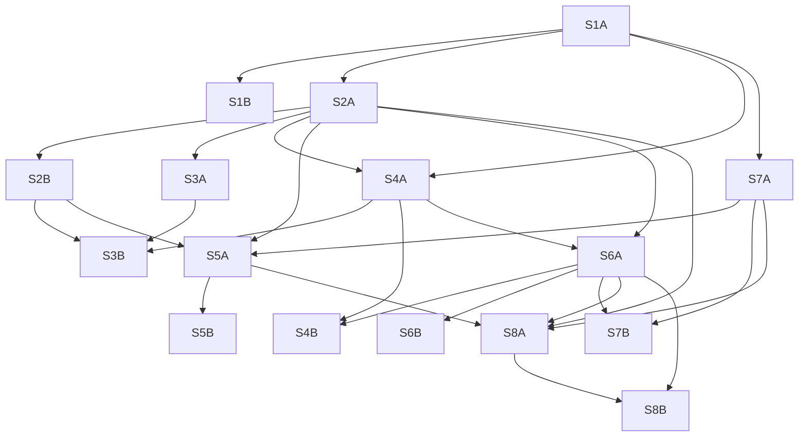

# Oikos execution plan: precise prerequisites and bounded implementation admission

2026-11-03. Current execution checkpoint with historical planning records;
accepted development source and S1A completion, not installed promotion or epic completion.
License: GPL-3.0-or-later.

## Current execution checkpoint and authority

Keep the existing [program narrative and epic index](oikos-local-first-workbench.md#epic-map)
as the entry point for the eight epics. This note describes execution of their
sixteen children, using the
[program manifest](../../.ημ/workflows/oikos-program.edn).
The manifest and this DAG are execution/review descriptions, **not canonical
Rheos authority**. All sixteen child vectors were subsequently synchronized
through Rheos and verified by official readbacks; the engine, not this note,
still owns admission, status and dependency transitions.
The coordinator must read live tasks before acting; saved card snapshots are
dated evidence, not a replacement board.

The installed Rheos engine enforces ordinary FSM/WIP gates; it does **not**
validate external code-artifact quality. The coordinator verifies those artifacts
under the user-approved precise-prerequisite policy. A data-only permit records
that assessment, not engine-enforced artifact admission or a second board engine.

### Implementation admission: current operator decision

The operator's latest **"Just go"** direction accepts the completed sixteen
independent planning reviews and locally verified planning corrections as
**implementation admission**, without waiting for hosted review cohorts or a
native review queue. The bounded authority is recorded in the
[local-review admission decision](../../.ημ/runs/oikos-program-20261103/decisions/local-review-admission.edn)
and the manifest's current execution fields. This supersedes the earlier
all-task planning hold; it does not manufacture native approval, waive
deterministic or safety checks, admit unverified successors, or complete a task.
Native PR findings and settlement evidence remain a separate obligation.

### Latest checkpoint: S1A accepted, merged and officially done

The parent qualified the full S1A development candidate
`fb9d7cd4a998459cee03d907c81b640a4ada22db`. All **seven concrete findings are
settled**: the first five retain their
[independent five-fix review](../../.ημ/runs/oikos-program-20261103/reviews/s1a-code-five-fix-review-v2.edn)
with the five provided source-file hashes unchanged at `fb9d7cd4`; the
[exact-head protocol review](../../.ημ/runs/oikos-program-20261103/reviews/s1a-protocol-fix-review-v2.edn)
settles the deadline and BOM defects, and the independent
[validator-boundary code review](../../.ημ/runs/oikos-program-20261103/reviews/s1a-validator-design-code-review.edn)
approves the introduced boundary within its stated owner-trust and timing limits.
These are actual scoped code reviews, not native-provider approval.

The [parent acceptance record](../../.ημ/runs/oikos-program-20261103/reviews/s1a-parent-acceptance.edn)
binds the exact candidate and actual reruns: **18 BB tests / 286 assertions**,
**40 NBB / 546**, **9 evaluation / 39**, and **0 lint errors / 0 warnings**.
The original **440,243-byte** case returned **timeout at about 5,990 ms with no
artifacts**, not a late success. Native import of **6,356,992 bytes** took about
**8 ms**; this is not a hard-real-time or start-entry responsiveness claim.
An actual owner-reviewed development-pin roundtrip returned `:ok`, **one
artifact** and **empty cleanup holds**. The parent corrected only its diagnostic
atom dereference, not product code or hold state; no success was inferred from
the initial logging error and no installed-worker authority is claimed.

Private [Oikos PR #1](https://github.com/open-hax/oikos/pull/1) was **MERGED at
19:42:34Z**, by an ordinary exact-`fb9d7cd4` merge at
`62e6eebbf75c3f2b28e4a550b4a01881a2f5e732`. The parent verified its two parents
`ae35073719974c0df1d2dae301c2179fa4785641` and
`fb9d7cd4a998459cee03d907c81b640a4ada22db`, and its exact reviewed tree
`8ed3ef2854d5b11522338e32e7e177dae893fc78`. Primary Oikos `main` was cleanly
fast-forwarded to that merge, **without installation or selected-generation
change**. The acceptance record's `not-yet-executed` merge field is its earlier
pre-merge checkpoint, not the current merge state.

The parent then observed official Rheos S1A readback **done**, after
`testing → review → document → done`. Parent epic
`722906b7-77d7-4414-a976-23996f7533de` and the empty dependency vector were
unchanged. At that completion checkpoint the official 24-card Oikos board was
**21 incoming, 2 in_progress, 1 done; zero epics done**. S2A and S7A were
`in_progress`; the later four-child wave is recorded below. These are parent
official observations, also recorded in the
[accepted S1A artifact permit](../../.ημ/runs/oikos-program-20261103/permits/s1a-accepted-62e6eebb.edn),
not a fresh board query or test run by this documentation worker.

The published private ref `artifact/oikos-s1a-62e6eebb` points exactly to the
merge and tree above. It provides development inert generation contracts and the
reviewed development-pinned renderer/validator boundary. The earlier
`generation-component-470c35e7` permit remains evidence of its narrower historical
scope; its old adapter is not retroactively qualified. Consumers must explicitly
import and verify the accepted newer artifact before any scope expansion.
Neither publication nor S1A completion grants new consumer operational permission,
installed immutable-worker selection, positive Bash, write-time safety, Services
promotion/rollback, operator effects or epic integration.

### Current wave: S3A done, decoder qualified, execution gates still held

The pushed coordinator is `81038b2123254783d4ec95f9338a87b8f3579834`, with newer
uncommitted reviews and official events. Parent official readbacks now report
**24 Oikos cards: 19 incoming, 3 in_progress, 2 done; zero epics done**. S1A and
S3A are done; the in-progress children are S2A, S4A and S7A. External owner prerequisites below
are separate cards, not additions to these 24 or to the 27-edge child DAG.
The parent successfully recorded the earlier continuation wave with the corrected closed-heredoc
receipt at `2026-11-03T21:15:37.769Z`. The earlier malformed unterminated-quote
command was rejected before execution and wrote nothing; no phantom receipt or
historical rewrite is implied.

| Workstream | Source checkpoint / consumed artifact | Current result and hold |
| --- | --- | --- |
| S2A frozen contract / qualified private decoder | Contract `c399b60e`; decoder `97e41a6b733f01e1b409f0f68f1efaf9122f5177` | Both decoder findings independently settled; owned synthetic integration continuation authorized; no actual phase-2 result or whole-S2A acceptance |
| S3A pure memberships/branches | Reviewed candidate `27adbfec5fd60302f93b1adf842dfd3f443644ab`; merge `008b0611198d13eb503bb57d5ef69d8dec1c268c` | Independently qualified, merged and officially done; caller supplies current accepted branch; no persistent CAS, live currentness or S3B movement admission |
| S4A typed named capability/revision contracts | `8ae64df4c7ad170c5de9206f4d3f712d44c60b43` | Pure contract reviewed, frozen and privately published by the recorded permit; no live dispatcher or runtime effects |
| S7A combined offline corpus/metrics/preflight | `9b4bc07be6a64dc7b69bdd7716a841162ba3168b` | All four P2 findings settled and offline artifact approved; full S7A remains `in_progress`; quality/speed/inference held |

The [S2A contract review](../../.ημ/runs/oikos-program-20261103/reviews/s2a-contract-code-v1.edn)
reproduced **P1 recursive metadata bypass**, retaining hidden secret/host-object
payloads, and **P2 runtime records accepted despite failure to round-trip through
the actual Clio `read-one` reader** at the original source. The implementer then
reproduced **225 BB/NBB RED failures** and recorded desktop GREEN at **16 tests /
1,059 assertions in each runtime** on `c399b60e`. Contract digest
`3cf52cca7310d1bf628f555fc6ffc86d416f55ebe527a7007f0d25eaa28eaa49`
is now **approved by the original independent reviewer**, with both findings
settled in the
[exact-source fix review](../../.ημ/runs/oikos-program-20261103/reviews/s2a-contract-fix-review-v2.edn).
Parent actual reruns passed desktop **16 / 1,059 in both BB and NBB**, inherited
**18 BB / 286**, **30 NBB / 392**, evaluation **9 / 39**, and lint **0/0**.
Published private ref `artifact/oikos-safe-reference-c399b60e` and the
[frozen contract permit](../../.ημ/runs/oikos-program-20261103/permits/s2a-contract-c399b60e.edn)
bind the actual independent report SHA-256
`e329a2fa6b171795a56c1800ac12893d5b1dccd1312f3cf0c7b01d9e0232542e`
and evidence UUID `b4542a1a-d95a-5fb5-a73d-3ba80bdd4692` to that exact contract.

The parent authorized the original S2A implementer to build **owned synthetic
actual Clio append, persistence, schema and locking fixtures**, including exact
envelope retry. This scoped owned-fixture continuation may now proceed under the
qualified decoder permit below; **no actual phase-2 result is claimed at this
checkpoint**. Its final integration qualification remains outstanding; decoder
approval is not evidence that the actual schema/history/locking fixtures passed.
The frozen contract must not drift before append; changed source needs fresh
independent review. Live collectors, operational content stores, personal capture
and operational retention/erasure claims remain held. No alternate Clio kernel
or validator is authorized; S2A is not done.

The earlier private same-captured-byte decoder candidate was
`7bd796cff3cf7f3365f1221e789bdb9e37bedaaf`, with **11 tests / 287 assertions in
each of BB and NBB**, lint **0/0**, and all nine frozen contract hashes unchanged.
Its narrow profile allows the default owner's literal bounded `#:namespace{...}`
map spelling while refusing raw `^`, `#_` and tags; it does not replace the owner
reader or weaken the frozen raw-data law. Its
[exact decoder review](../../.ημ/runs/oikos-program-20261103/reviews/s2a-wire-code-v1.edn)
returned **changes requested**: **P1 namespace-expanded key alias collapse** and
**P2 raw partition-container metadata laundering**. That historical failure is
not carried forward as an open defect on the reviewed successor.

The [exact successor review](../../.ημ/runs/oikos-program-20261103/reviews/s2a-wire-fix-review-v2.edn)
now **approves both fixes** at `97e41a6b733f01e1b409f0f68f1efaf9122f5177`, with
**15 tests / 347 assertions in each runtime**, the inherited full suite green,
lint **0/0**, and all nine frozen contract files unchanged. The
[wire continuation permit](../../.ημ/runs/oikos-program-20261103/permits/s2a-wire-97e41a6b.edn)
binds review SHA-256
`46c9cffc0afd5976b7b4c751d2a46828c3c836bc4b2ad207d4c6568508526003`,
the four reviewed wire-file hashes and the original frozen contract. The parent
has authorized the original implementer to finish **owned synthetic actual Clio
schema/history, locked append and fresh-process persisted replay fixtures**.
Preserve those nine plus four files; actual effects tests and independent
exact-head integration review still precede acceptance. No actual phase-2 result
or full-S2A completion is claimed.

The parent verified the exact provided pure lifetime and Clio-backed replay
artifact for S3A (`b2f52c1f-bd1b-431e-a417-95c72549ba0d`) and S4A
(`29caa8e3-289a-416c-9850-8ef9cc769e88`). Each officially walked
`incoming → accepted → breakdown → ready → todo → in_progress`; existing
producer UUID dependencies were retained, not replaced by a false S2A completion.
Both isolated worktrees initially fast-forward imported `c399b60e`. The original
dispatches were S3A `ses_e5cf49282ffeOrMeSLNNzvC0eC` for **pure logical
membership/named-branch laws only**, and S4A `ses_e5cf49280ffeu6M5FZg2Eew6QC` for
**typed named capability and revision-bound contracts only**. Live i3/Emacs
effects, dispatcher installation and operational reuse of the old `470c35e7` BB
transport remain held. Those prerequisite assessments and ordinary Rheos
transitions were not engine validation of code quality or child completion;
S3A's later reviewed merge and official completion are recorded next.

The [completed pure S3A review](../../.ημ/runs/oikos-program-20261103/reviews/s3a-code-v1.edn)
approves only `8642b46e`'s caller-current membership/branch laws. Its accepted-S1A
composition at `27adbfec5fd60302f93b1adf842dfd3f443644ab` has now fully passed the
[independent integration-code review](../../.ημ/runs/oikos-program-20261103/reviews/s3a-integration-v2.edn).
The complete 600-second-budget invocations passed; the earlier 120-second timeout
remains incomplete historical evidence, not a product failure. Parent fresh
spaces tests passed **11 / 455 in BB and NBB**, with lint **0/0**.

Native complete-page collection found **zero threads/findings**. Codex's passing
exact-head receipt **6615777023**, with summary **6615747480**, was verified and
recognized by the tool as Codex approval. CodeRabbit's check was **SUCCESS**, but
its Free summary was **not** a full approving review. MiMo/Kimi workflow routes
were absent; no completed hosted cohort or synthetic native approval is claimed.
Under the explicit independent-local-review override, ordinary exact-head
[Oikos PR #2](https://github.com/open-hax/oikos/pull/2) merged at **22:27:45Z** as
`008b0611198d13eb503bb57d5ef69d8dec1c268c`, with parents accepted S1A `62e6eebb`
and exact reviewed candidate `27adbfec`. The parent verified merge-tree equality
to `06d714dd42ec2b12cd51bdc37e1b4b0fe67d9f3b`, clean primary Oikos `main`
fast-forward, and normal private publication/readback of
`artifact/oikos-s3a-008b0611`.

The [accepted S3A permit](../../.ημ/runs/oikos-program-20261103/permits/s3a-accepted-008b0611.edn)
binds those facts. Its parent-to-record board field is the pre-transition
checkpoint: the later fresh official worker readback confirms
`in_progress → testing → review → document → done`, retaining the existing E3
parent and UUID dependencies. **S3A is the second done Oikos child**, not a done
epic. The caller must still provide its current accepted branch; pure predecessor
conflict laws do not supply persistent atomic CAS or live currentness. This
source-composition review is **not fresh epic integration**, and no S3B movement
or live effects are admitted.

The [pure S4A review](../../.ημ/runs/oikos-program-20261103/reviews/s4a-contract-code-v1.edn)
passed **11 tests / 99 assertions in both runtimes**, plus **652 independent
checks per runtime**. The now-present
[S4A freeze/publication permit](../../.ημ/runs/oikos-program-20261103/permits/s4a-contract-8ae64df4.edn)
records actual create-only private publication of
`artifact/oikos-capability-8ae64df4` at that exact source; this is a completed
publication record, not merely a dispatched agent. Its next scope is **source-
grounded trusted-dispatcher/owner-authority planning only**. Functional runtime
implementation, live i3/Emacs effects, dispatcher installation and whole-S4A
completion remain unqualified.
The [dispatcher plan](../../.ημ/runs/oikos-program-20261103/reviews/s4a-dispatcher-plan-v1.edn)
is under a new independent planning review, not implementation admission. No live
or native shim exists as a qualified result of this planning work.

The [S7A code/artifact review](../../.ημ/runs/oikos-program-20261103/reviews/s7a-code-v1.edn)
originally required four P2 corrections: text-label/scorer mismatch, phase loss between
trial metrics and summaries, memory telemetry contradicting pinned total
capacity, and an image-inventory audit that does not require complete unique
coverage. The current candidate's six PNGs were present; the last finding is an
audit-admission defect, not a claim that those files are missing. The
[independent four-fix re-review](../../.ημ/runs/oikos-program-20261103/reviews/s7a-code-fix-review-v2.edn)
now settles all four and approves the **combined offline artifact** at
`9b4bc07b`. Parent fresh checks passed **26 BB tests / 357 assertions**, **38 NBB /
463**, **9 evaluation / 39**, **7 artifact tests / 181**, and lint **0 errors /
0 warnings**. The v2 file SHA-256 matched
`0085e3d5123e6e219d541aab81c2a4f15a7dc3a876d4cf8db6f44aca2397da24`.
Private ref `artifact/oikos-s7a-offline-9b4bc07b` and the
[data-only offline permit](../../.ημ/runs/oikos-program-20261103/permits/s7a-offline-9b4bc07b.edn)
retain this exact scope. **No S5A admission** follows from this offline artifact
alone: its required artifact bindings, remaining S2B prerequisite and owning
real-runtime completion evidence are not supplied by the offline permit. Full
S7A is still `in_progress`; quality, speed and inference remain held. Its original
author's separate offline simulator had three P2 findings in the
[runner review](../../.ημ/runs/oikos-program-20261103/reviews/s7a-ocr-runner-code-v1.edn).
The [independent fix review](../../.ημ/runs/oikos-program-20261103/reviews/s7a-ocr-runner-fix-review-v2.edn)
now approves all three fixes at `7cd9320f2c9991f8e36e15e59478b80789ae3b25`
**OFFLINE ONLY**, including **544 additional passing checks**. The runner-v2
file SHA-256 is
`2c291f6f4598b00da1197a8ae3b560042c56bbba9f971ca6d4efa9befbdd948b`;
the qualified corpus v2 is unchanged. Normal private publication/readback of
`artifact/oikos-ocr-runner-7cd9320f` is recorded in the
[offline runner permit](../../.ημ/runs/oikos-program-20261103/permits/s7a-runner-offline-7cd9320f.edn).
The live CLI remains blocked; this is no execution or whole-S7A admission.

The [hard-runner specification](../../.ημ/runs/oikos-program-20261103/reviews/s7a-hard-runner-plan-v1.edn)
is under independent planning review, **not authorized implementation or
execution**. Its proposed aggregate **256 MiB client cgroup** covers three Python
roles—supervisor/watchdog, network worker and durable writer—not an uncounted
helper or only an interpreter heap. The allocator/cgroup boundary, durable
full-raw-evidence store and retention executor, watchdog limits, real HTTP,
response-instance binding, fresh resource/authority and no-second-hop gates
remain unqualified. Neither simulator approval nor this design resolves those
unknowns, supplies a live executor, permits a POST, or renews the consumed restart.

The user selected **"Build owner prerequisites"**, recorded in the
[S1B owner-prerequisite authorization](../../.ημ/runs/oikos-program-20261103/decisions/s1b-owner-prerequisites-authorization.edn).
Independent owner planning reviews and corrections now admit RED/GREEN in the
isolated Services/shx owner worktrees. Two **external prerequisite cards**, neither
carrying the Oikos label or counted among the 24, are officially `in_progress`:

- **Services:** `3f5d0052-dda2-4089-971d-8603e385bd77`, exact plan
  `f8d63271bd3d14cc6ce5ec33466c6e8a747d5d10`, spec SHA-256
  `500be9073f22ae74e880e50a55627802274911a136059f92dcf53ac023bcf112`.
  The [four-correction planning re-review](../../.ημ/runs/oikos-program-20261103/reviews/services-generation-plan-fix-review-v2.edn)
  closed all four findings at planning scope. The later Caddy-backed environment
  pass below does not establish **full engine/JVM qualification**; earlier focused
  29-test/static passes were not a waiver.
- **shx:** `577a41a3-3778-417b-b65d-186c12a521bf`, exact plan
  `79ca039d0137aca1e59ebdbf4cd16eb46f737495`, spec SHA-256
  `2dbeda258a384caa089e64ec578f57abfa85e123581559a603e55615c2abdcdc`.
  The [planning fix re-review](../../.ημ/runs/oikos-program-20261103/reviews/shx-safe-bash-plan-fix-review-v2.edn)
  settled its sole P2. The visible typechecker deprecation remains a qualification
  hold; actual strict gates, implementation review and mutation evidence are
  future work, not supplied by planning approval.

Owner implementation continues in those isolated worktrees; **no qualified API
is available yet**. Sandbox fixtures only, no installed promotion; unrelated root Services/shx
dirt is preserved. S1B remains **incoming**. Its own worktree only fast-forward
prepared accepted S1A `62e6eebb`; parent reruns of **18 BB / 286, 40 NBB / 546,
9 evaluation / 39, lint 0/0** are prerequisite checks, not S1B implementation.
Do not invent an Oikos-owned substitute kernel. Independent code review precedes
consumer admission, and fresh epic integration still requires both owning
children to qualify.

The [Services partial implementation record](../../.ημ/runs/oikos-program-20261103/reviews/services-generation-implementation-v1.edn)
binds the earlier portable-law tranche at `a7e56794f8872be558d423f10c1979033bd08e36`,
not an available anchored OS engine. The architect is now implementing that engine;
its outcome is not yet established. The later
[isolated Caddy test-cache authorization](../../.ημ/runs/oikos-program-20261103/decisions/caddy-isolated-test-cache-authorization.edn)
permits only the workflow-pinned **Caddy 2.8.4** public binary and checksum in an
agent-owned fixture cache, with **no installation or service startup**. The parent
reports the actual download/checksum verified and supplied this ready path to the
Services architect:

```text
CADDY_TEST_BINARY=/tmp/opencode/oikos-test-tools/caddy-2.8.4-12fac7e8-ed63-49cc-b3b3-773bf3841773/caddy
```

The [canonical cache handoff](../../.ημ/runs/oikos-program-20261103/reviews/caddy-test-cache-v1.edn)
now identifies the worker's actual coordinator-root
[`reviews/caddy-test-cache-v1.edn`](../../reviews/caddy-test-cache-v1.edn), preserving
its exact **5,313 bytes** rather than pretending it originally occupied the run
directory. Parent streaming rehash verified the **14,595,001-byte** archive,
SHA-256 `a7e8306c54138cf88e371c5ec0caf7baf142ecc1d60a30897dfb67d65d3748c8`,
and **40,681,624-byte** binary,
SHA-256 `d3491373b2d78e4eaa3f498b42852d399d404b0df3f274bbee66d62c12084be0`.
The Services author now reports **134 passing Caddy-backed environment tests**.
The actual SIGKILL matrix and three further RED cases—clock rollback, replay
reporting and limit diagnostics—are still running. No unprinted new head, full
engine/JVM qualification or owner API handoff is claimed; cache preparation is
not installation or a service startup.

The [earlier shx partial record](../../.ημ/runs/oikos-program-20261103/reviews/shx-safe-bash-implementation-v1.edn)
is historical. Latest parent-reported progress is `151dff49…`: **44 tests / 330
assertions** in the strict pass and **21 BB plus 21 NBB transport cases**, with
exact v5 bundle pins in owner-repository
`docs/verification/safe-bash-transport-v2.edn`. The **same architect continues**;
production deadline/cancellation/descendant/effect proof and the typed.clojure
deprecation-warning hold remain unfinished. These intermediate passes do not
grant S1B API admission or a qualified renderer/validator handoff.

### Current OCR activation: consumed restart, input identity only

The [independent concrete-unit review](../../.ημ/runs/oikos-program-20261103/reviews/ocr-attestation-concrete-review-v3.edn)
approved the prepared release/unit. The parent then performed the sole authorized
restart of source `6626d680f079c3330fee1df1f3565475d7ef1a55`; the
[activation outcome](../../.ημ/runs/oikos-program-20261103/decisions/ocr-attestation-activation-outcome.edn)
records **one restart, zero additional starts: the grant is consumed**.

The [completed independent runtime review](../../.ημ/runs/oikos-program-20261103/reviews/ocr-attestation-runtime-v1.edn)
verified **PID 3187253**, **start ticks 45402858**, the exact source and all five
consumed asset-input hashes/lengths, reported **OpenVINO 2025.4.1** and NPU target,
and a fresh **1,167-byte** identity response SHA-256
`c35e58936c5f2cdfb3f1293678bff85d9cc3446a1f32e8c795c15d9caa33d985`.
This qualifies startup input identity and successful native initialization under
the reviewed trust base—not compiled-artifact identity, all dependency identity,
physical-device tracing, OCR quality/speed or a cold-start benchmark. **No OCR
POST or measurement was performed.** Original dirty owner source/unit fragment
and the private rollback backup remain preserved.

The [owner persistence report](../../.ημ/runs/oikos-program-20261103/reviews/ocr-owner-persistence-v1.edn)
records **only the active owned override committed** as
`470a96888c21f9a467f8d06f7802e88f3021302b` on `device/stealth`; **no source or
unit pushes** were performed. Public source publication would expose private historical
conversation metadata, and a normal unit push would publish five unrelated
unpublished ancestors. No private historical title is reproduced here. The
[publication hold](../../.ημ/runs/oikos-program-20261103/decisions/ocr-owner-publication-held.edn)
records the private-snapshot versus keep-local question as **unanswered**, with
**no selected destination or consent**. Remote backup is not verified. Preserve
the local commits, release, exact rollback evidence and consumed marker: no
deletion, force push, ancestry rewrite or assumed private-snapshot permission.
This persistence hold changes neither the running `Restart=no` service nor its
runtime identity and entails no new HTTP or restart.

The user explicitly chose
[keep automatic restarts off](../../.ημ/runs/oikos-program-20261103/decisions/ocr-recovery-restart-no.edn):
retain **Restart=no** and authorize **zero additional starts**. A future crash
stays visible; neither automatic recovery nor another manual/rollback startup is
authorized.

The separate [conditional six-image authorization](../../.ημ/runs/oikos-program-20261103/decisions/ocr-six-image-conditional-authorization.edn)
allows **one** batch of the six frozen synthetic PNGs, **at most six sequential
POSTs, 5 seconds/request, 30 seconds total, and a 256 MiB client ceiling**, on the
existing loopback worker only. **Execution is still held and the batch grant is
not consumed**: hard process/time/memory bounds, an independently reviewed runner
and real HTTP/response-identity binding, durable raw evidence storage, fresh
resource/authority context, no-second-hop review and explicit parent execution
admission remain required. Operator consent is not a GovOne signed-policy verdict
or resource reservation. No retries, extra batches, starts, downloads/new model
loads, personal inputs, E4B loading, cloud or spending are granted.

### OCR identity attestation: narrow authorization, not activation

**Historical pre-activation checkpoint:** the inventory, old PID and pending-unit
review below describe the prepared state before the consumed restart above, not
current blockers or a claim that activation has not happened.

The [S7A runtime inventory](../../.ημ/runs/oikos-program-20261103/reviews/s7a-runtime-inventory-v1.edn)
initially identified port **8099** `ocr-npu.service`, PID **1371874**, and
on-disk OCR assets. **Loaded source/model identity was then unknown**: the working
server differs from repository HEAD and its file changed after process startup.
Health metadata and disk hashes do not attest the bytes loaded by that worker.

The later [explicit question-tool authorization](../../.ημ/runs/oikos-program-20261103/decisions/ocr-attestation-restart-authorization.edn)
permits a **reviewed identity-reporting change and one controlled restart of the
existing `ocr-npu.service`, using existing assets only**. Owner-i3 patch
`6626d680f079c3330fee1df1f3565475d7ef1a55` corrected the P2 startup-binding guard;
the [independent fix review](../../.ημ/runs/oikos-program-20261103/reviews/ocr-attestation-fix-review-v2.edn)
approved it after the nine-test suite and 84 malformed cases. This is scoped code
and plan approval, not a live runtime attestation.

The parent's [concrete preflight](../../.ημ/runs/oikos-program-20261103/reviews/ocr-attestation-concrete-preflight.edn)
records exact committed server/launcher export to the new root-owned read-only
release `/opt/desktop-ocr/releases/6626d680f079c3330fee1df1f3565475d7ef1a55`.
A new owned user-unit drop-in, SHA-256
`9a0236217a54f59a1444d9029dc0a0efc3fac530d8f7b5ba382014c51765567c`,
sets `Restart=no` and resets `ExecStart` to the same absolute `/usr/bin/python3`
with the new launcher. `daemon-reload` completed and user-unit verification exited
**0**. The original i3 dirty source and unit fragment are untouched; the private
rollback backup was retained. **At that preflight PID 1371874 was still running,
NRestarts=0; no restart, model load, warm execution or OCR POST had yet occurred.**

Two unrelated existing unit warnings remain visible: ytwall's assignment outside
a section and barrier's StartLimit key in the Service section. Verification is
not a global warning-free claim, and no unrelated unit fix was requested.
**Independent final review of the concrete composed unit was still pending before
the sole authorized restart at that checkpoint.** This operator-authorized OCR source/unit
preparation is not Oikos installed-generation promotion, runtime identity proof,
or permission for the six-image batch or E4B loading. The inventory's earlier
proposal-only text predates the grant; neither permission nor preparation counts
as activation or post-restart attestation.

That initial grant authorized **no downloads, personal inputs, OCR batch execution, six-image
batch, E4B load, unrelated service/model changes, cloud use or spending**. Loaded
identity and actual resource admission were separate gates; the restart grant
alone supplied neither inference permission nor quality/speed qualification.
The later input-identity result and conditional, still-held batch grant are
recorded above; no repeated restart follows from either.

### Historical component-scoped wave: coordinator `de5c276d`

The following checkpoint predates the full S1A acceptance and official completion
above. Its two BB findings and whole-S1A hold were then open, not current blockers
on the accepted `fb9d7cd4` source. The old component permit still describes only
the old source's permitted consumer scope, not automatic reuse of the newer API.

The coordinator was at `de5c276ddd8362353598b2f3322dfc338cdcb42b`, with later
official Rheos events. S1A
(`07452a65-4a6a-4704-bf81-50408927dcc8`) has walked
`incoming → accepted → breakdown → ready → todo → in_progress → testing`
and remained **testing**. The coordinator verified that S2A
(`93a76dad-678a-4980-86fb-ba0fbb5e8203`) and S7A
(`0db50b53-6c7a-489a-bff9-048d57ce4cbb`) each walked
`incoming → accepted → breakdown → ready → todo → in_progress`, retaining their
S1A UUID dependency. The 24 Oikos cards then comprised
**1 testing + 2 in_progress + 21 incoming**, with **zero Oikos tasks or epics
done**. Counts and transitions are attributed to the coordinator's official
readbacks; this documentation worker has not queried live board state or rerun
implementation suites.

| Workstream | Frozen source, imported head or merge | Qualification and evidence limit at this checkpoint |
| --- | --- | --- |
| S1A reviewed generation component | `470c35e7d5bfdfbfd1a93bec3a1f63357015df69` | Five manifest/isolation/input findings settled; two BB protocol defects were then open; whole S1A was not yet accepted |
| S2A isolated artifact import | `185c0480167c9e42f62d30271b1d25db3334581e` | `in_progress`; initial safe-reference contract and pure projection laws only; actual Clio append held |
| S7A isolated artifact import | `d8ea33ed22f7cf22099816ff1642ab17a83d4568` | `in_progress`; offline corpus, metrics and bounded identity preflight; inference held without actual resource admission |
| Standalone receipt-transport repair | `542ec7b12bc275661ce1a6c2dda009d621e5706f` | Qualified PR #53 merge; DONE through its own Rheos authority, outside the 24 Oikos cards |

The first five manifest/isolation/input findings have a RED revision
`aeb6c555f1dc1916e70127755672c4b5848bec91` and GREEN revision
`470c35e7d5bfdfbfd1a93bec3a1f63357015df69`. The
[independent five-fix re-review](../../.ημ/runs/oikos-program-20261103/reviews/s1a-code-five-fix-review-v2.edn)
settles exactly those five findings, not all S1A obligations. The coordinator's
actual rerun at that revision passed **18 BB tests / 286 assertions**, **30 NBB /
392**, **9 evaluation / 39**, and clj-kondo **0 errors / 0 warnings**.

Two BB protocol defects were separately
[independently confirmed](../../.ημ/runs/oikos-program-20261103/reviews/s1a-protocol-findings-skeptic-v1.edn):
blocking parent validation defeats the spawn-relative deadline (P1), and decoder
BOM erasure hides invalid frame/stderr bytes (P2). The author was repairing a new
trusted-validator boundary; the
[deadline design recommendation](../../.ημ/runs/oikos-program-20261103/reviews/s1a-validation-deadline-design.edn)
was design evidence, not a verified fix. Neither defect was settled by the
five-fix review or aggregate green suites; whole-S1A acceptance was held until the
later exact-head reviews and parent acceptance above.

### Historical component permit and initial child dispatch

The coordinator qualified **only the needed generation, read-only filesystem
isolation and synthetic-fixture component**, published privately as
`artifact/oikos-generation-component-470c35e7`. The
[data-only component permit](../../.ημ/runs/oikos-program-20261103/permits/generation-component-470c35e7.edn)
pins the source files, digests, shared fixture and independently reviewed evidence.
It supplies portable manifests/canonical identity, closed profile/context inputs,
read-only isolation and fixture identity—not BB transport/deadline qualification,
positive Bash, write-boundary safety, promotion or rollback. This is coordinator
artifact verification under the user's precise-prerequisite policy, **not whole
S1A acceptance or native Rheos validation of artifact quality**.

The two initially dispatched isolated implementers were:

- **S2A:** `ses_e5d2c562cffe1l3wrcvlYejueK`, phase 1 initial versioned
  safe-reference contract and pure projection laws. Actual Clio append remains
  held until the separate independent contract review; a pure fixture is not
  append admission or live collector activation.
- **S7A:** `ses_e5d2c560bffec14ejyJvHl4NMf`, offline synthetic corpus, metric
  oracles and bounded existing-endpoint identity preflight. Inference remains
  held without independently established actual resource admission; identity
  observation alone does not provide it.

Both consumers were forbidden to invoke the old `oikos.infra.bb-render/start!`
operationally. The containing commit's old adapter code is not retroactively a
qualified prerequisite merely because newer source was later accepted. Bash,
promotion, service/model changes and cloud effects were held at this checkpoint;
the later narrow OCR authorization above is not a general waiver. Neither child
was done. Producer UUID
dependencies and the existing 27-edge DAG are unchanged; only the verified
component is consumed within the named scopes.

Independent post-implementation review for every task and fresh epic integration
after both children are verified remain required future work. Active
implementation, a narrow component permit or passing aggregate tests count as
neither completed child review nor epic integration.

### Historical first-code checkpoint: before the component-scoped wave

S1A's first [pushed code candidate](https://github.com/open-hax/oikos/commit/7896ee8709a9461ee54e2d39739c5ee8ce1a3157)
was on private [Oikos PR #1](https://github.com/open-hax/oikos/pull/1), with S1A
testing and the other 23 Oikos cards incoming. At that earlier checkpoint the
coordinator reran **15 BB tests / 245 assertions**, **25 NBB / 314**, evaluation
**9 / 39**, and lint **0 errors / 0 warnings**. Code review and protocol probes
were still active and no successor had been admitted then. They subsequently
returned the five code findings and two protocol findings distinguished above;
the old all-successors-waiting snapshot is not the current board state.

### Receipt repair: qualified source promotion and verified merge

The repair was merged at `542ec7b12bc275661ce1a6c2dda009d621e5706f` through
[personal Foresight PR #53](https://github.com/riatzukiza/foresight/pull/53).
The repair uses a finite **16 MiB combined stdout/stderr capture budget**, not a
whole-process memory limit, and closes the owned target descriptor when committed
capture fails before reservation. The
[independent code review](../../.ημ/runs/oikos-program-20261103/receipt-repair-code-review-v1.edn)
passed **123 tests / 833 assertions** plus **52 adversarial probes**, with zero
findings. The separate
[bounded integration review](../../.ημ/runs/oikos-program-20261103/receipt-repair-integration-review-v1.edn)
also reported zero findings for exact source identity, target-prefix
preservation, new receipt admission and archive custody; it was not a repeated
full code audit.

The coordinator's actual parent verification from trusted base
`e31b43a57765a394521d6c49aafd068f5c4d5ad5` to merge
`542ec7b12bc275661ce1a6c2dda009d621e5706f` returned a strict **PASS: 557 records,
10 appended**. This is the actual base-to-merge pair, not a HEAD-to-itself pass.
The earlier `ENOBUFS` checkpoint is no longer a current blocker on this lineage.

The earlier [merge preflight](../../.ημ/runs/oikos-program-20261103/receipt-repair-merge-preflight.edn)
previewed byte-preserving union, not receipt-shape admission. The
[receipt-shape custody assessment](../../.ημ/runs/oikos-program-20261103/receipt-shape-custody-assessment.edn)
showed that the donor's string-valued `:manifest` and `:refs` would still fail
the unchanged envelope law. That merge strategy was superseded by the
[selective source-promotion record](../../.ημ/runs/oikos-program-20261103/receipt-repair-source-promotion.edn):
exactly the reviewed `scripts/evidence.clj` and `test/evidence_cli_test.cljs`
blobs were promoted, not the complete repair branch or its receipt suffix.
The promotion record's pending-review fields describe its historical pre-review
checkpoint, not the current qualification state.

The entire original malformed-receipt lineage's archived version
`036cfd03a58314b2672632057820f3bd42214729` on remote
`riatzukiza/foresight:evidence/receipt-git-buffer-20261103` remains reachable.
The independent integration review verified that version's full **1,289,238
ledger bytes** remotely against the local archive, byte-for-byte and by SHA-256.
All three malformed records remain unchanged there; the complete target prefix
was preserved. No schema
waiver, historical record rewrite, convenient trusted-base substitution or
native approval transfer occurred. The original branch's full-history failure
is not relabeled a pass by this separate source promotion.

The standalone repair is now **DONE through its own Rheos authority**. Its
[completion archive `be0ec132`](https://github.com/riatzukiza/foresight/commit/be0ec132b7e6f03f7590431a00584c93c1f7db58)
retains the original lineage plus completion events. The coordinator verified
exact remote receipt, event and done-card bytes, including **1,291,543 receipt
ledger bytes** and **317,471 event ledger bytes**. The earlier `036cfd03` version
remains reachable; its older byte count is not the completion archive's count.
[Planning PR #52](https://github.com/riatzukiza/foresight/pull/52) is now **CLOSED**,
superseded by merged PR #53, without branch deletion or operational-state
transplant. This standalone completion adds no Oikos child or epic completion.

### Review-route planning: nonblocking follow-up

Safe review-route planning was separately authorized, but the latest steering
makes it **nonblocking for locally reviewed implementation**. No follow-up
infrastructure work has started and no credentials have changed. Missing hosted
routes or lagging native queues do not reinstate the superseded implementation
hold. Fork guards, trusted publisher identity, credential isolation and all
effect restrictions remain intact.

The manifest's frozen planning-review instructions still describe the earlier
all-incoming checkpoint. Read them as historical review input, not as an override
of the later admission decision or live Rheos state.

### Historical native-gate view: superseded for implementation admission

At the original `b9ac3141` checkpoint,
[planning PR #153](https://github.com/open-hax/foresight/pull/153) had sixteen
unsettled native threads and two body items. After publishing `51d80fad`, the
coordinator settled all sixteen threads and posted both itemized body replies;
native readback at that checkpoint reported zero unresolved threads. Review of
the subsequent `f3b039c0` head raised three new threads: two identify the same
safe-reference producer-order defect, and one requests a public-only setup
example. Those later findings required their own verified corrections and native
settlement; this note claims no new native settlement or approval for them.
Current-head review/convergence and the receipt-history gate were blocked at that
checkpoint. No ready transition, task completion or integration completion was
asserted then. **All sixteen tasks were blocked by planning admission** under
that earlier rule, even dependency-free S1A. The current operator decision above
supersedes that implementation hold, not the historical native evidence.

## Historical planning checkpoint, before final dispositions

This superseded checkpoint combines the coordinator's reported state with the
persisted
[skeptic reconciliation](../../.ημ/runs/oikos-program-20261103/skeptics/reconciliation.edn),
read for this documentation update. Official board state at that checkpoint was
reported as **24 incoming / 0 done**; the documentation worker has not performed a new live Rheos
or native GitHub query.

All sixteen owned worktrees exist. Sixteen independent planning review reports
produced **53 candidate findings**. Both 53-ID skeptic passes are now persisted;
the reconciliation validates matching ID sets and classifies them as:

| Comparison classification | Count | Meaning at this checkpoint |
| --- | --- | --- |
| Consensus remaining | 12 | Acceptance-criteria corrections assigned to a separate worker; not yet verified complete |
| Consensus historically addressed | 14 | Agreement about prior planning corrections, not implementation proof |
| Consensus refuted | 4 | Agreement about candidate refutation, not task approval |
| Disputed | 23 | Adjudication pending; neither settled nor approved |

The 12 acceptance-criteria corrections were being applied separately. At that
earlier documentation check, `consensus-fixes-v1.edn` had not been found under the
program run, so completion was not claimed. The
[subsequently recorded corrections](../../.ημ/runs/oikos-program-20261103/consensus-fixes-v1.edn)
and their independent verification belong to the later admission evidence.
Two persisted passes alone are not a completed
qualified review round, exact-head approval or settlement of all findings.
At this earlier checkpoint, PR #153's original sixteen threads and two body
items were still open. Their later native settlements are recorded below;
local review classification alone did not resolve native review state.

### Historical S1A preparatory specification, not implementation

The coordinator reports an independent re-review of the preparatory S1A
specification found all three P2 findings fixed. The specification SHA-256 is
`8bed8627de1f3c4f79ff70f5156f8bbd854e0566e684fe9b1d7fc8fb54c125f0`.
It is committed privately as `92df993` on `feat/oikos-s1a`:
[pinned specification](https://github.com/open-hax/oikos/blob/92df993/docs/specs/s1a-generation-contracts.md).
The native private [Oikos PR #1](https://github.com/open-hax/oikos/pull/1) is
reported **OPEN** at that checkpoint. This was preparatory specification evidence
only: no task implementation or planning admission was inferred from it. The
parent Oikos gitlink must not advance to this unmerged source merely because the
specification was pushed.
The original architecture/smoke links below retain their original source pin.

### Historical receipt-buffer diagnosis

A separate diagnosis/planning branch, `fix/receipt-git-buffer-20261103`, had
commit `7a0d842` and a then-open stacked personal
[Foresight PR #52](https://github.com/riatzukiza/foresight/pull/52), as reported
by the coordinator. The actual `ENOBUFS` failure was unchanged then. The diagnosed
cause is a **1 MiB** buffer cap against a roughly **1.28 MiB** ledger; the
historical prefix is safe. A finite **16 MiB** cap was proposed, **not implemented**
at that diagnosis checkpoint; the later qualified source promotion and merge are
recorded above.
Diagnosis, a planning commit and an open PR are not runtime repair evidence.

### Existing baseline only

At that checkpoint, the coordinator reported the passing baseline below. These
suites were not rerun by the documentation worker and qualify no future
acceptance criterion:

| Scope | Tests / assertions |
| --- | --- |
| Root project | 12 / 171 |
| Root workspace | 24 / 122 |
| Child BB | 5 / 37 |
| Child NBB | 8 / 59 |
| Child evaluation | 9 / 39 |
| Lint | 0 errors / 0 warnings |

Safety policy is unchanged. Per-task post-implementation adversarial code review
and fresh epic integration remain **future required work**, not merely dispatched
work being counted as complete. Planning reports, spec re-review and baseline
tests replace none of those gates. All tasks retained the planning-admission
hold at this historical checkpoint; the later operator decision supersedes that
hold for scoped implementation, not these verification requirements.

## Nine operator policy answers

These are bounded program policy decisions, not blanket execution permits:

1. Qualified program merges are authorized; qualification and native review
   settlement still apply. Authorization is not an approval record.
2. Deployment is sandbox/dev only, not installation or production promotion.
3. Personal capture and personal-data upload are held: use synthetic inputs only.
4. Retention is 24 hours for images and 7 days for text; deletion propagates to
   derived data. Accepted knowledge requires explicit consent, not automatic
   promotion of generated observations. A later per-task review clarified the
   accepted-payload rule through the question tool: consent must name an expiry
   or explicitly select indefinite retention for that item. Accepting a claim
   alone extends no deadline, and raw sources still expire. This decision is
   retained in `.ημ/runs/oikos-program-20261103/decisions/accepted-retention.edn`.
5. Autonomy covers agent-owned resources only. Operator-owned windows, buffers,
   resources and attention require explicit approval; joining remains deliberate.
6. Models use existing resources only. Download, load and restart actions remain
   held; this includes 12B experiments.
7. Cloud use is synthetic-only, through the actual `mojomast/govone` policy
   session, and only with verified no-charge admission. A supposedly free
   provider is not evidence of admission.
8. Paid spending is **0**; historical Colab budgets grant no inherited authority.
   Real remote tool publication/account setup, including ChatGPT, remains held.
9. Dependency precision may replace whole-epic waits with verified specific child
   artifacts. This does not weaken effect, governance or planning gates.

**Original narrow exception (historical pre-activation checkpoint):** the
[OCR identity-attestation authorization](#ocr-identity-attestation-narrow-authorization-not-activation)
authorized only the reviewed identity-reporting change and **one** controlled
`ocr-npu.service` restart with existing assets, after independent review and
parent activation. Other download/load/restart holds above remain in force.
It does not authorize an OCR/six-image batch, personal inputs, E4B load or other
service/model changes. No restart had occurred at that earlier checkpoint; the
actual consumed grant and runtime evidence are recorded above.

**Current precise exceptions, not blanket weakening:** the sole OCR restart is
now consumed, automatic recovery remains off, and no further start is authorized.
The separate one-batch six-image consent remains conditional and unconsumed until
all reviewed hard-boundary, durable-evidence, resource/authority and HTTP/identity
gates pass. The isolated pinned Caddy fixture-cache download is authorized, not
system installation, service startup, model downloading or Services acceptance.
The original personal-data, cloud/GovOne, spending, installation and effect holds
remain in force outside these explicit scopes.

## Sources and privacy

Oikos is private. These source links are pinned to
`ae35073719974c0df1d2dae301c2179fa4785641`; access is required, and an
unauthenticated 404 is not proof that a private artifact is absent:

- [Workbench architecture](https://github.com/open-hax/oikos/blob/ae35073719974c0df1d2dae301c2179fa4785641/docs/architecture/workbench.md).
- [Measured synthetic perception smoke](https://github.com/open-hax/oikos/blob/ae35073719974c0df1d2dae301c2179fa4785641/docs/research/perception-smoke-2026-11-03.md).

Do not turn private child paths into relative GitHub links through the public
Foresight submodule directory. Source privacy does not authorize capture data,
credentials or runtime state in Git.

## Isolated ownership and task-key dictionary

Each child owns a distinct Oikos branch/worktree, not a shared checkout:
`/home/err/spaces/foresight/oikos/.worktrees/feat/oikos-<task-key>`.
For example S1A uses `feat/oikos-s1a` at that full base path. All sixteen paths
below were created at source `ae35073719974c0df1d2dae301c2179fa4785641` and
verified with `git -C oikos worktree list` by the coordinator. This is workspace
existence, not implementation progress. Sixteen separate read-only adversarial
planning review reports now exist; their session identities are retained in
`.ημ/runs/oikos-program-20261103/reviewer-sessions.edn`. The historical checkpoint
records their then-unresolved reconciliation; the later verified fixes and
operator decision supply bounded implementation admission, not native approval
or whole-task code acceptance by themselves. S1A's later accepted development
source and official completion, the historical component permit, and the current
S2A/S7A repair holds are recorded separately above.
The Foresight coordinator stays in
`/home/err/spaces/foresight/.worktrees/plan/oikos-execution-20261103` on
`plan/oikos-execution-20261103`; child implementation belongs in Oikos.

| Key | Canonical task UUID | Artifact/outcome | Owned branch suffix | Required artifact prerequisites |
| --- | --- | --- | --- | --- |
| S1A | `07452a65-4a6a-4704-bf81-50408927dcc8` | Isolated generation manifests and render contracts | `feat/oikos-s1a` | None; scoped implementation admitted |
| S1B | `3d14e0a5-2790-42b8-9a55-54d686925c3c` | Services-owned preview/check/apply/rollback | `feat/oikos-s1b` | S1A |
| S2A | `93a76dad-678a-4980-86fb-ba0fbb5e8203` | Clio causal event admission and EDN replay; initial versioned safe-reference contract and reviewed handoff | `feat/oikos-s2a` | S1A |
| S2B | `59774be2-cc61-4708-9030-8b7b42935ec3` | i3 subscribe/snapshot race and reconnect reconciliation | `feat/oikos-s2b` | S2A |
| S3A | `b2f52c1f-bd1b-431e-a417-95c72549ba0d` | Logical memberships and speculative projection branches | `feat/oikos-s3a` | S2A |
| S3B | `912b707f-2275-45c9-b4a9-aac143e11d9a` | Sandbox leases and deliberate human joining | `feat/oikos-s3b` | S3A, S2B, S4A |
| S4A | `29caa8e3-289a-416c-9850-8ef9cc769e88` | Scoped named i3/existing-Emacs operations | `feat/oikos-s4a` | S1A, S2A |
| S4B | `27ff00af-536d-4d7d-a9ad-a09b5ec2aaf3` | Shared client adapter qualification matrix | `feat/oikos-s4b` | S4A, S6A |
| S5A | `0e124c65-694e-44f1-9959-ee83e81ca22b` | Bounded local OCR/E4B perception adapter | `feat/oikos-s5a` | S2A, S2B, S7A |
| S5B | `7d0235f1-ab69-4095-b404-bcc1ca60db91` | Epistemic knowledge, retention, forgetting and stop controls | `feat/oikos-s5b` | S5A |
| S6A | `c703893f-aea4-41c2-9eab-c3bd37b28c9b` | All-egress GovOne policy/session binding | `feat/oikos-s6a` | S2A, S4A |
| S6B | `0d11e7a7-c131-4c91-aaf7-55ad8ec26002` | Scoped Knoxx Lens evidence and gateway history | `feat/oikos-s6b` | S6A |
| S7A | `0db50b53-6c7a-489a-bff9-048d57ce4cbb` | Frozen synthetic OCR baseline and runtime identity probes | `feat/oikos-s7a` | S1A |
| S7B | `18ef840f-23cb-4dd5-bc19-a2a5aeb279c3` | Actual 12B backend and governed comparison qualification | `feat/oikos-s7b` | S7A, S6A |
| S8A | `2a08e0cb-e029-46ae-b217-399d0d3ebf42` | Consented corrected labels and leakage-safe partitions | `feat/oikos-s8a` | S2A, S5A, S6A, S7A |
| S8B | `3cd09bfd-f214-4e16-817d-c36cffe21376` | Reproducible governed Colab export with spending holdback | `feat/oikos-s8b` | S8A, S6A |

Epic keys E1–E8 correspond in order to the linked epic index; each owns its
matching A/B pair. Their UUIDs remain in that index and the manifest.

## Current child-artifact DAG: 27 acyclic edges

Arrows mean prerequisite artifact → consumer, not completed work. The sixteen
child nodes now have **27 acyclic edges**, rather than the former 26: the explicit
S2A → S5A edge names the initial safe-reference contract producer. Scoped
implementation admission does not admit every successor; each still needs its
exact verified prerequisite artifacts and lawful Rheos transition.



Precision removes unnecessary waits, not safeguards. For example S3A consumes
S2A's verified event/projection contract rather than waiting for all of E2;
S5A needs S2A's initial versioned safe-reference contract, S2B's reconciliation
artifact and S7A's baseline. The
[`safe-reference-order-fix-v1.edn`](../../.ημ/runs/oikos-program-20261103/safe-reference-order-fix-v1.edn)
records the added edge and contract handoff. The coordinator reports that
independent scoped review `ses_e5d669c6cffeaq3v812wQXRMuV` confirmed the cards,
workflow, official Rheos correction and README; its sole P3 finding was the
missing S2A prerequisite in this note's S5A row and diagram, corrected here.
That scoped confirmation is not native approval or implementation acceptance.
The correction artifact's all-incoming readbacks describe its earlier planning
checkpoint, not current board state.
S5A must consume the exact independently reviewed S2A version, digest, source and
review evidence; S5B may add only separately reviewed compatible prospective
extensions, not become a future predecessor or retroactively qualify history.

A dispatch permit must name the exact prerequisite artifact, tested revision
and verification evidence, plus
the consumer scope and allowed effects. Worker self-report is insufficient.
The coordinator must reconcile proposed changes through Rheos before treating
them as canonical dependencies; this note performs no board writes.

**GovOne is preserved:** S4B, S7B, S8A and S8B still explicitly depend on S6A's
egress binding. Replacing an E6-wide wait with S6A is not permission to bypass
GovOne, its authenticated policy session, denial, provenance or no-charge check.
Text, images, labels, tool returns and exports all remain governed. Any other
task acquiring an egress path must also obtain that verified prerequisite and
scope-specific policy admission before using it. Denial never means direct
provider retry. S6B's Lens/history work remains independently required for its
own epic; it is not silently declared complete by S6A's permit.

## Per-task review and dispatch protocol

1. Independently review each child's planning artifacts and acceptance criteria.
   The completed sixteen separate reviews and locally verified fixes have been
   accepted by the operator for scoped implementation admission. Do not wait for
   hosted cohorts or a native queue to begin that reviewed work; preserve native
   settlement obligations separately. Use Rheos for lawful ready admission.
   Program-level discussion alone cannot substitute for per-child review.
2. Verify prerequisite artifacts at exact revisions before issuing a scoped
   dispatch into the child's own worktree. A dependency-free root still needs
   planning admission and the same policy checks.
3. Implement laws/tests in red, then domain/adapters in green. Record actual
   commands, exit status, runtime identity and evidence limits. Run applicable
   tests, lint and analysis; do not replace absent runtime proof with a mock pass.
4. Dispatch an independent adversarial reviewer **after implementation for each
   task**. The implementer cannot approve itself. Confirm findings with a
   skeptic before treating them as confirmed, fix and re-review as needed, and
   keep native PR settlement separate from harness-local review evidence.
5. Only verified prerequisite artifacts can admit successors. A worker exit,
   green synthetic fixture or review request is neither approval nor completion.

The installed `ultra.bb` compatibility blocker is explicit in the manifest: it
injects retired OpenCode `--dir` and expects `agent list`, absent from the active
v2 CLI. Use explicitly identified harness-native review dispatches and the
coordinator's content-hash journal; do not claim the ultra CLI ran, silently
substitute a provider, or patch global skills for this program.

## Fresh epic integration, then documentation

After **both** children of an epic have independently verified implementation
and post-implementation review evidence, dispatch a **fresh integration agent**.
It must test their composition at named revisions and the owning runtime seams,
including denial and noninterference, not simply concatenate child reports.
Integration is **not complete by mock**. A policy-held real path remains a
visible integration limitation even if its local contract fixture passes.

After integration evidence is reviewed, dispatch/update documentation to record
the composed behavior, exact tested revisions, outstanding holds and changed
operator instructions, retaining links to the existing epic index. Rheos alone
records any lawful epic transition. No integration, documentation update or merge
may invent an unavailable approval or turn a policy-blocked criterion into pass.

## Historical review-disposition and native-gate checkpoint

These records retain the sequence before the current implementation admission.
Their earlier holds and specification-only states do not override the current
execution checkpoint above.

Both skeptic passes preserve all 53 original candidate IDs. Their twelve agreed
remaining contracts were amended and independently verified at planning scope.
The 23 disagreements were then adjudicated against source and inherited
requirements, not counted as automatic third-vote confirmation: eighteen were
already-required/historical obligations, two were covered by the preparatory
specification, two needed clarifications, and one remains unverified integration.
The two clarifications now require an independent branch predecessor for edits
and continued accounting for supplier work after client timeout/disconnect.
Their independent verification and the Lens compatibility hold remain separate
from implementation acceptance.

The S1A specification advanced to private commit
`95dfbdb26f65fac8b17bcb11cd192ba47d8efe3c` after two native Codex scope findings:
initial S1A acceptance is positive inert profile EDN plus truthful unavailable
Bash rejection; actual positive Bash and non-vacuous write-time race/rollback
proof stay under S1B's owner-artifact gates. Both native threads were fixed and
resolved. At that point the PR contained a specification, not working code or
readiness evidence. That historical specification alone did not supply the later
exact-head acceptance. The actual subsequent reviewed source merge and official
S1A done readback are recorded above, without installed or epic qualification.

PR #153's sixteen original threads were subsequently settled as fixed at
`51d80fad`; both identified body findings were answered in the
[itemized writer reply](https://github.com/open-hax/foresight/pull/153#issuecomment-6611238670).
The canonical status readback observed zero unresolved threads but no exact-head
approval or completed planning round, and requested fresh collection after a
concurrent evidence change. At that checkpoint the actual receipt verifier exited
2 with `spawnSync git ENOBUFS` and the separate repair had not been implemented.
Those settlements alone did not admit implementation or complete an epic; the
later explicit operator decision supplies the bounded implementation admission.
That verifier failure was not waived. The later source promotion, independent
qualification and actual base-to-merge pass are recorded in the current checkpoint;
the old failure is not a current `ENOBUFS` block on the merged lineage.

The separate repair plan subsequently advanced to `4deeab6d`. Its specification
now includes owned-target descriptor cleanup when committed capture fails after
opening the target, exactly-once closure and repeated-failure descriptor tests,
and combined stdout/stderr capture accounting. Independent local review and a
native CodeRabbit reply accepted this **planning correction**. At that planning
checkpoint the source and regression tests were unchanged and the repair card
remained incoming. That was planning evidence only. The later completed repair,
independent review and qualified source-promotion merge are recorded above;
neither a whole donor-branch merge nor a passing malformed history is claimed.

The [native route diagnosis](../../.ημ/runs/oikos-program-20261103/native-review-route-diagnosis.edn)
separates fork eligibility from provider availability. PR #153's pinned MiMo
workflow deliberately skips fork heads; rerunning cannot change that predicate.
The private Oikos repository exposes no hosted review workflow, and neither
target has an established Kimi execution/admission route. These are missing
target routes, not quota exclusions or approvals. The current operator decision
makes route follow-up nonblocking for reviewed implementation; no new follow-up
infrastructure or credential change is claimed. Existing fork guards, publisher
identity checks and credential isolation remain required.

Exact duplicate JSON review inputs and Rheos readbacks are preserved in the
[pushed evidence manifest](https://github.com/riatzukiza/foresight/blob/e2939d28e1b7ecbeb441dfd6fbac358c4300081a/.%CE%B7%CE%BC/runs/oikos-program-20261103/readback-manifest.json):
55 files, 275,056 raw bytes. Authenticated remote tree/blob checks matched the
local bytes and manifest SHA256. Active local mirrors remain untracked and
retained; nothing was deleted. Separating generated duplicates keeps the
canonical planning PR bounded without paying for larger review scope. This
evidence archive is neither a second board nor review approval.

## Policy-blocked test evidence

| Path | What may be prepared | What remains held or unproven |
| --- | --- | --- |
| S4B remote clients | Synthetic adapter contracts and local compatibility fixtures | Actual remote ChatGPT tool publication/account setup is held; loopback or a mock does not qualify it |
| S5A perception | Synthetic transport and resource-control checks | Actual E4B availability, admitted resources and image quality require observation; the earlier unavailable endpoint is not a pass |
| S7B model qualification | Existing-resource probes and reproducible qualification plans | 12B download/load/restart is held; actual backend, co-residency and useful speed cannot be inferred from theoretical fit |
| S8B/cloud | Synthetic export preparation and denial tests | Paid spending remains 0; no paid allocation, personal-data upload or inherited Colab budget; even no-charge use requires verified GovOne admission |
| All personal capture paths | Synthetic retention/deletion/pause/stop scenarios | Personal-data collection and disclosure remain held; synthetic tests do not authorize them |

Blocked tests are recorded as blocked, not skipped-to-green or waived. Qualified
local changes may be reviewed within their scope, but neither task acceptance
nor whole-epic completion is fabricated from partial evidence. New effect
authority requires an explicit operator decision and recorded admission.
