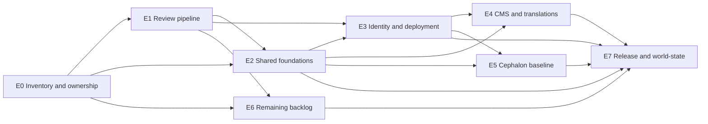

# Foresight Stabilization — Epic Portfolio

Portfolio adopted for registration on October 20, 2026 from the October 19 proposal.
Eight coordination epics, **44 story slots** (the proposal says 43 but lists 44).
Slots describe obligations and link work; they are not 44 newly created tasks.

## Program and authority

The existing program [Complete the inflight portfolio and begin purified Knoxx extraction](../agile/kanban/760f7f1e-a086-4e0a-82a5-71d2a761073d.md)
(`760f7f1e-a086-4e0a-82a5-71d2a761073d`) remains the single program anchor.
This portfolio is its stabilization coordination annex. Existing card UUIDs,
parents, accepted scope and histories remain intact. The eight `stabilization-eN`
epics are new coordination cards beneath that anchor; their incoming status is
registration, not qualification or permission to merge.

Stabilization reconciles inherited work into a reproducible baseline. Goal
completion proves product capabilities. Restarting either agent is a separate
explicit decision based on exact source pins and unfinished work. These three
outcomes are tracked independently.

The CMS/translations delivery track links existing translation/SME-review and
content/layout/publication cards separately. The Cephalon delivery track retains
physical graph, independent mood and authorized recall as its goal. Wider
always-on personality and social-creative work remains subsequent scope.

The [tracker](tracker.md) is a navigation and evidence projection. Rheos card
state remains operational authority. The [work graph](work-graph.json) records
canonical UUID links and unresolved mappings, not a replacement board engine.
The [existing inflight specification](../specs/inflight-completion-and-knoxx-lift.md)
continues to govern evidence. No shared law, source pin, deployment or restart
is accepted merely by registering this portfolio.

## Qualification dependencies

Edges gate qualification. Independent source archaeology and bounded repairs may
proceed while prerequisite evidence is gathered. E6 additionally inherits each
module's evidenced shared dependencies; it need not wait for unrelated CMS or
Cephalon work. Epic dependency vectors are planning relationships; accepted
source compatibility must still be proven for each actual merge candidate.

| Gate | Milestone | Required evidence |
| --- | --- | --- |
| M0 | Baseline frozen | Exhaustive upstream/fork census, exact heads/bases, owners, preserved unique sources and evidenced relationships |
| M1 | Review pipeline qualified | Protected checks, accepted reviewer path and exact-source fork-to-upstream-to-consumer proof |
| M2 | Shared foundations reconciled | Qualified portable data/event contracts and accepted consumer pins |
| M3 | Identity/deployment boundary settled | Accepted provider boundary and executed authorization, release and integration tests |
| M4 | CMS backlog reconciled | All CMS PR dispositions, integrated source and precise functional evidence; residual goal recorded |
| M5 | Cephalon baseline reconciled | Adopted design, integrated source and separately evidenced B1, B2 and B3 statuses |
| M6 | Remaining backlog closed | No unresolved PR in the frozen cohort; every unique implementation preserved |
| M7 | State-of-the-world release | Reconstructable source manifest, release matrix, audited closure, residual goals and two handoffs |

A milestone is qualified, unqualified or blocked by a named obligation; it has
no subjective percent-complete field. M5 may truthfully report unproven B1–B3
while baseline reconciliation is complete, provided every residual acceptance
obligation is owned in the continuation handoff. M7 does not assert either
product goal is complete. An externally blocked open PR is reportable progress
but is **not** a terminal closed disposition for M6 or M7.

## Epic contracts and story reconciliation

Every slot below retains the proposed scope. Its proof is the minimum exit
contract. Related links are discovery candidates unless E0 verifies exact
coverage; no unrelated card is silently reparented, reopened or marked done.
Missing mappings stay explicit. Search child-owned Rheos and GitHub work before
creating any missing execution story. Repository plus UUID qualifies identity;
matching titles alone never establish equivalence.

## E0 — Reconstruct the authoritative backlog

We need to know exactly which work exists, how branches overlap, and which source is authoritative before merging anything.

Canonical epic: `stabilization-e0`. Qualification gate: `M0`. Prerequisites: none.

### E0.1 — Freeze the PR census: Capture all upstream and personal PRs with immutable head SHAs, reviews, checks and base branches.

**Exit proof:** All declared upstreams and personal forks are enumerated through the last API page; each PR has immutable head/base SHAs, reviews, checks and review-thread evidence. Missing access is an explicit gap.

**Existing work:** [Existing PR reconciliation](../agile/kanban/reconcile-the-opening-pull-request-portfolio.md) (`0d73c22a-b018-4b8c-92fe-560127f53294`); [Pinned repository census](../agile/kanban/establish-the-pinned-repository-census-94175066.md) (`a1d0645d-49a6-4e8d-b744-4e1a94175066`)

### E0.2 — Identify unique implementations: Distinguish stacked branches, duplicate source, old snapshots and changes that haven't reached upstream.

**Exit proof:** For every overlapping stack, retain ancestry, patch/blob comparisons and a source-preservation decision; titles and age do not prove duplication.

**Existing work:** [Existing PR reconciliation](../agile/kanban/reconcile-the-opening-pull-request-portfolio.md) (`0d73c22a-b018-4b8c-92fe-560127f53294`)

### E0.3 — Reconcile Rheos ownership: Connect existing PRs, UUIDs, cards, epics and dependencies without creating duplicate tasks.

**Exit proof:** Each cohort item maps to repository-qualified canonical card UUIDs, existing parent epics, accountable owner and evidenced dependencies; unresolved matches stay unresolved.

**Existing work:** [Existing PR reconciliation](../agile/kanban/reconcile-the-opening-pull-request-portfolio.md) (`0d73c22a-b018-4b8c-92fe-560127f53294`); [Fork development and org promotion epic](../agile/kanban/epic-develop-on-riatzukiza-forks-orgs-receive-promotions-and-run-ops--origins.md) (`fork-dev-origins`)

### E0.4 — Preserve historical work: Secure unique code, evidence, Cephalon designs and unpublished fixes.

**Exit proof:** Unique code, unpublished fixes and the October 7/8 Cephalon design are retained in retrievable immutable commits or content-addressed artifacts before any closure.

**Existing work:** [Inaccessible census revisions](../agile/kanban/recover-inaccessible-census-revisions-3c4226e3.md) (`dabfaac3-c388-4979-827b-0cd93c4226e3`)

### E0.5 — Establish campaign rules: Allow only necessary repairs during stabilization, with explicit ownership and history preservation.

**Exit proof:** Record repair-only scope, per-stack ownership, exceptions and preservation obligations on the existing program.

**Existing work:** [Layered evidence gates](../agile/kanban/codify-revision-bound-layered-evidence-gates.md) (`4f263499-a765-4b0f-bac0-7f8175672d60`)

**Definition of done:** Every PR has an owner, intended disposition and verified dependency relationship. The census is complete, not capped by a GitHub search-result limit.

## E1 — Qualify the review and merge pipeline

We cannot close hundreds of PRs reliably if the review infrastructure itself remains inconsistent.

Canonical epic: `stabilization-e1`. Qualification gate: `M1`. Prerequisites: E0.

### E1.1 — Qualify Muse: Resolve complete-input review and evidence-directory handling.

**Exit proof:** A complete-input Muse review retains evidence-directory inputs and a revision-bound result; omitted input fails qualification.

**Existing work:** [Layered evidence gates](../agile/kanban/codify-revision-bound-layered-evidence-gates.md) (`4f263499-a765-4b0f-bac0-7f8175672d60`); [Exact-commit execution isolation](../agile/kanban/isolate-exact-commit-evidence-execution-be44f659.md) (`c9cfd94c-4c18-4469-acf4-d79fbe44f659`)

### E1.2 — Qualify Eta Mu and Proxx: Establish source-bound reviews, independent reviewer identity, complete verdicts and failure recovery.

**Exit proof:** Eta Mu and Proxx demonstrate independent authorized reviewer identity, complete verdicts and failed-run recovery at exact source revisions.

**Existing work:** [Authenticated promotion evidence](../agile/kanban/authenticate-promotion-evidence-989b31ef.md) (`f66c6539-d719-48ae-8284-18fd989b31ef`)

### E1.3 — Qualify fork promotions: Ensure accepted personal-fork work reaches the appropriate organization without dropping newer history.

**Exit proof:** Demonstrate a fork-to-upstream protected merge with preserved newer history and consumer verification at exact commits.

**Existing work:** [Fork development and org promotion epic](../agile/kanban/epic-develop-on-riatzukiza-forks-orgs-receive-promotions-and-run-ops--origins.md) (`fork-dev-origins`)

### E1.4 — Resolve outstanding findings: Test fixes, rerun current-head reviews, and settle actual review threads.

**Exit proof:** Each substantive finding has a tested current-head disposition and its actual review thread settled; older approvals cannot transfer.

**Existing work:** [Existing PR reconciliation](../agile/kanban/reconcile-the-opening-pull-request-portfolio.md) (`0d73c22a-b018-4b8c-92fe-560127f53294`)

### E1.5 — Add merge-drift verification: Recheck affected consumers after each shared dependency is accepted.

**Exit proof:** Accepting a shared source triggers verification of affected consumers at named pins; failures leave that combination unqualified.

**Existing work:** [Layered evidence gates](../agile/kanban/codify-revision-bound-layered-evidence-gates.md) (`4f263499-a765-4b0f-bac0-7f8175672d60`)

**Definition of done:** We can demonstrate at least one complete fork → reviewed upstream PR → protected merge → verified consumer update, with no approval or evidence incorrectly transferred between revisions.

## E2 — Reconcile shared contracts, events and persistence

Clio, Rheos, Katamorph and the receipt infrastructure are the shared foundations of both goal agents.

Canonical epic: `stabilization-e2`. Qualification gate: `M2`. Prerequisites: E0, E1.

### E2.1 — Clio: Admit segmented ledgers, exact retries, canonical replay and durable recovery.

**Exit proof:** Segmented ledger admission, exact retry, canonical replay and durable recovery pass real persistence and failure-path tests.

**Existing work:** [Sol/Clio dependency card](../agile/kanban/replace-sol-legacy-ledger-dependency-with-clio.md) (`replace-sol-legacy-ledger-dependency-with-clio`)

### E2.2 — Rheos: Resolve document identity, duplicate UUIDs, frontmatter custody and lawful lifecycle updates.

**Exit proof:** Document identity, duplicate UUID rejection, frontmatter custody and lifecycle transitions have executable lawful and refusal cases.

**Existing work:** Unresolved; locate the owning child card/issue before creating execution work.

### E2.3 — Document history: Preserve concurrent revisions, source relationships and event provenance.

**Exit proof:** Concurrent revisions preserve source relationships and provenance through persistence/replay without silent overwrite.

**Existing work:** Unresolved; locate the owning child card/issue before creating execution work.

### E2.4 — Katamorph and Foresight shapes: Reconcile portable semantic laws with representation-specific adapters.

**Exit proof:** Portable .cljc semantic contracts are distinguished from host adapters and tested at producer and consumer boundaries; lifts remain explicit decisions.

**Existing work:** [Layered evidence gates](../agile/kanban/codify-revision-bound-layered-evidence-gates.md) (`4f263499-a765-4b0f-bac0-7f8175672d60`)

### E2.5 — Receipt River and consumers: Qualify append-only evidence, reader semantics and exact downstream pins.

**Exit proof:** Append-only writes, reader behavior and consumer pins are verified at exact accepted revisions without rewriting historical receipts.

**Existing work:** [Authenticated promotion evidence](../agile/kanban/authenticate-promotion-evidence-989b31ef.md) (`f66c6539-d719-48ae-8284-18fd989b31ef`)

**Definition of done:** Shared event and data contracts have qualified implementations, and consumers use the accepted revisions without silently changing history.

## E3 — Settle identity, deployment and OpenPlanner integration

The main CMS merge conflict isn't merely textual. It reflects incompatible identity ownership between current Knoxx and the older Wiki stack.

Canonical epic: `stabilization-e3`. Qualification gate: `M3`. Prerequisites: E1, E2.

### E3.1 — Decide Axxium ownership: Resolve the remote-versus-embedded provider boundary documented in [Knoxx #324](https://github.com/open-hax/knoxx/issues/324?utm_source=chatgpt.com).

**Exit proof:** An accepted remote/embedded-provider decision preserves or explicitly migrates principal, membership and session semantics; #324 supplies a reconciliation reference.

**Existing work:** Unresolved; locate the owning child card/issue before creating execution work.

### E3.2 — Qualify Knoxx authorization: Test login, logout, sessions, MCP authority, revocation and cross-tenant refusal.

**Exit proof:** Executed login/logout/session, MCP authority, revocation and cross-tenant denial tests name the actual integration head and environment.

**Existing work:** Unresolved; locate the owning child card/issue before creating execution work.

### E3.3 — Resolve Axxium's upstream PRs: Settle concurrency and OAuth-state findings.

**Exit proof:** Each Axxium upstream PR and its concurrency/OAuth-state findings has a verified disposition with current-head evidence.

**Existing work:** Unresolved; locate the owning child card/issue before creating execution work.

### E3.4 — Qualify Services: Verify protected deployment authority, required secrets, staging and rollback.

**Exit proof:** Protected deployment admission, secret requirements, staging and rollback have executed evidence without recording secret values.

**Existing work:** [DigitalOcean deployment acceptance](../agile/kanban/record-digitalocean-deployment-acceptance-86af1ffc.md) (`ff0803c0-9b04-4623-8725-516886af1ffc`)

### E3.5 — Promote OpenPlanner: Resolve [Foresight #139](https://github.com/open-hax/foresight/pull/139?utm_source=chatgpt.com) and establish accepted runtime/source pins.

**Exit proof:** Foresight #139 has an evidenced disposition and OpenPlanner runtime/source pins are accepted explicitly; listing a proposed submodule does not admit it.

**Existing work:** Unresolved; locate the owning child card/issue before creating execution work.

**Definition of done:** Identity and deployment interfaces are compatible across the accepted repositories, with executed integration tests.

## E4 — Reconcile Knoxx CMS and translation work

We want all existing CMS implementation work preserved and merged into a coherent application before asking an agent to continue feature development.

Canonical epic: `stabilization-e4`. Qualification gate: `M4`. Prerequisites: E2, E3.

### E4.1 — Recompose PR #305: Reconcile its 23 extracted layers with current main, newer PR #387, PR #388 and personal fork #19.

**Exit proof:** A movement ledger accounts for all 23 extracted #305 layers against main, #387/#388 and personal #19, with source/blob provenance and no newer code lost.

**Existing work:** [Existing PR reconciliation](../agile/kanban/reconcile-the-opening-pull-request-portfolio.md) (`0d73c22a-b018-4b8c-92fe-560127f53294`)

### E4.2 — Qualify content history: Source locale, revisions, approved media, human review decisions and stale-source refusal.

**Exit proof:** Source locale, revisions, media approval, human decisions and stale-source refusal pass through actual content-history adapters.

**Existing work:** [Content/layout/publication delivery card](../agile/kanban/prove-content-generation-layout-publishing-and-review-independently.md) (`3fd1fdf7-dc2e-4b2a-bb5a-7979a686529e`)

### E4.3 — Qualify translations: Ensure English and Spanish use their correct independent review and publication conditions.

**Exit proof:** English and Spanish independently demonstrate their required review and publication conditions, including negative cases.

**Existing work:** [Translation and SME review delivery card](../agile/kanban/prove-translation-generation-and-sme-review-independently.md) (`abdd5a2d-dbad-46a0-ba3f-2149dfeafbcf`)

### E4.4 — Stabilize persistence and embeddings: Durable publication receipts, Qwen migration, readback after restart and rollback.

**Exit proof:** Publication receipts and embedding migrations survive restart/readback and support a tested rollback; Qwen claims identify actual model and dimensions.

**Existing work:** [Content/layout/publication delivery card](../agile/kanban/prove-content-generation-layout-publishing-and-review-independently.md) (`3fd1fdf7-dc2e-4b2a-bb5a-7979a686529e`)

### E4.5 — Run complete application verification: Backend/frontend tests, lint, migration ratchets, protected release evidence and browser tours.

**Exit proof:** Applicable backend/frontend, lint, migration and protected release gates pass at the integrated head; browser or headless product acceptance follows the accepted product contract.

**Existing work:** [Layered evidence gates](../agile/kanban/codify-revision-bound-layered-evidence-gates.md) (`4f263499-a765-4b0f-bac0-7f8175672d60`); [DigitalOcean deployment acceptance](../agile/kanban/record-digitalocean-deployment-acceptance-86af1ffc.md) (`ff0803c0-9b04-4623-8725-516886af1ffc`)

### E4.6 — Merge and reconcile: Account for all CMS PRs without overwriting newer code.

**Exit proof:** Every frozen CMS PR is merged, verifiably superseded, split-and-closed or declined-and-closed with preserved source and rationale.

**Existing work:** [Existing PR reconciliation](../agile/kanban/reconcile-the-opening-pull-request-portfolio.md) (`0d73c22a-b018-4b8c-92fe-560127f53294`)

**Definition of done:** The CMS source is reconciled and its actual running capabilities are reported precisely. The remaining agent goal is documented if end-to-end operation is not yet proven.

## E5 — Preserve and qualify Cephalon's creative-loop baseline

We need to preserve the actual physical graph, independent mood and authorized recall design rather than letting the resumed agent redefine its goal.

Canonical epic: `stabilization-e5`. Qualification gate: `M5`. Prerequisites: E2, E3.

### E5.1 — Adopt the design: Bring the October 7 character-memory document and October 8 accepted milestone into the Foresight mainline.

**Exit proof:** Locate and retain the exact October 7 design and October 8 accepted milestone revisions, then obtain explicit mainline adoption; the pasted summary is not design authority.

**Existing work:** Unresolved; locate the owning child card/issue before creating execution work.

### E5.2 — Qualify Field ownership: Reconcile the Eros/Eris physical model, numerical contracts, persistence and replay.

**Exit proof:** Field Eros/Eris ownership, numerical units/contracts, persistence and replay are verified from the owning source and actual tests.

**Replay adoption hold:** The [revision-bound candidate and missing qualification evidence](../../.ημ/stabilization/snapshots/cb557fa52f4c487a870eba580bf7c9d6c5f2942098321f643c45fc02677c6cb0.json) retain the recovered same-target formula, compared fields and exact-equality requirements. The candidate is proposed only. Before replay can qualify E5.2/E5.5, the adopted contract must reference a new immutable record naming the accepted comparator/values, exact field paths and units, source/runtime/configuration, independent review and executed replay evidence. No tolerance or B1–B3 result is adopted by this checkpoint.

**Existing work:** Unresolved; locate the owning child card/issue before creating execution work.

### E5.3 — Reconcile OpenPlanner: Preserve authorization before graph traversal, bounded search, feedback deduplication and truthful results.

**Exit proof:** OpenPlanner proves authorization before traversal, bounded search, feedback deduplication and truthful found/empty/refused results.

**Existing work:** Unresolved; locate the owning child card/issue before creating execution work.

### E5.4 — Integrate Knoxx's character adapter: Reconcile [personal Knoxx #14](https://github.com/riatzukiza/knoxx/pull/14?utm_source=chatgpt.com) with accepted runtime source.

**Exit proof:** Personal Knoxx #14 is compared and reconciled against the accepted runtime pin; preserve adapter behavior and provenance.

**Existing work:** Unresolved; locate the owning child card/issue before creating execution work.

### E5.5 — Define executable B1–B3 verification: Require actual persisted encounter state, consumed mood transition and automatic prompt-level recall.

**Exit proof:** B1 proves persisted encounter state across restart; B2 proves an independently stored mood transition is consumed; B3 proves automatic authorized recall reaches the actual character prompt. Record each separately.

**Existing work:** Unresolved; locate the owning child card/issue before creating execution work.

### E5.6 — Produce a continuation handoff: Exact source pins, uncompleted stories, safe runtime limits and acceptance evidence.

**Exit proof:** A source-pinned handoff names unfinished canonical stories, safe runtime bounds, B1/B2/B3 evidence and restart prerequisites.

**Existing work:** Unresolved; locate the owning child card/issue before creating execution work.

**Definition of done:** The accepted design and implementation branches have coherent provenance, and B1, B2 and B3 each have an independently evidenced status.

B1, B2 and B3 begin **unassessed in this checkout**. The source proposal reports 0/3 live proofs; this registration does not verify that historical claim. A passing unit fixture cannot stand in for persisted encounter state, consumed mood or actual prompt-level recall.

## E6 — Close the remaining Foresight constellation backlog

We need to finish the entire inherited queue, not just the two actively developed products.

Canonical epic: `stabilization-e6`. Qualification gate: `M6`. Prerequisites: E0, E1.

### E6.1 — Truth: Reconcile physics, performance, native interaction, represented life, water accounting and Gate planning.

**Exit proof:** All frozen Truth PRs covering physics/performance/native interaction/life/water/Gate planning have source-preserving terminal dispositions.

**Existing work:** Unresolved; locate the owning child card/issue before creating execution work.

### E6.2 — Agent/tooling modules: Proxx, Muse, Sol, Shx, Katamorph, UXX and supporting packages.

**Exit proof:** Proxx, Muse, Sol, Shx, Katamorph, UXX and supporting-tool PRs each have repository-owned gates and terminal dispositions.

**Existing work:** [Fork development and org promotion epic](../agile/kanban/epic-develop-on-riatzukiza-forks-orgs-receive-promotions-and-run-ops--origins.md) (`fork-dev-origins`); [Sol/Clio dependency card](../agile/kanban/replace-sol-legacy-ledger-dependency-with-clio.md) (`replace-sol-legacy-ledger-dependency-with-clio`)

### E6.3 — Knowledge and media modules: Epiphany, Calliope, Bitch Tracker, Osmos, Receipt River and other independent children.

**Exit proof:** Epiphany, Calliope, Bitch Tracker, Osmos, Receipt River and remaining knowledge/media PRs have terminal dispositions without broad child-policy rewrites.

**Existing work:** Unresolved; locate the owning child card/issue before creating execution work.

### E6.4 — OpenPlanner historical backlog: Reconcile old fix pairs and source compatibility instead of blindly merging old branches.

**Exit proof:** Old OpenPlanner fix pairs are compared against accepted sources and compatibility tests before merge or evidenced supersession.

**Existing work:** Unresolved; locate the owning child card/issue before creating execution work.

### E6.5 — Foresight root: Accept or supersede overlapping architecture, archaeology, cognitive-substrate and operating-contract planning.

**Exit proof:** Overlapping root architecture, archaeology, cognitive-substrate and operating-contract plans are explicitly accepted or superseded; existing planning epics retain their identities.

**Existing work:** [Layered operating contracts epic](../agile/kanban/epic-layered-operating-contracts.md) (`layered-operating-contracts`)

### E6.6 — Resolve every PR disposition: Close superseded and declined work only after its source and rationale are accounted for.

**Exit proof:** Every cohort PR has a verifiable terminal outcome and every useful split has an existing canonical successor; externally blocked open work still blocks M6.

**Existing work:** [Existing PR reconciliation](../agile/kanban/reconcile-the-opening-pull-request-portfolio.md) (`0d73c22a-b018-4b8c-92fe-560127f53294`)

**Definition of done:** The complete frozen cohort has terminal, verifiable dispositions. No unique implementation disappears during cleanup.

## E7 — Produce the release baseline and state-of-the-world report

This is the outcome that makes the entire stabilization campaign useful.

Canonical epic: `stabilization-e7`. Qualification gate: `M7`. Prerequisites: E0, E1, E2, E3, E4, E5, E6.

### E7.1 — Reconstruct Foresight: Validate root, submodules, source metadata and documentation against exact accepted commits.

**Exit proof:** The root, direct gitlinks, source metadata and documentation reconstruct from an immutable release manifest with no unexplained drift.

**Existing work:** [Pinned repository census](../agile/kanban/establish-the-pinned-repository-census-94175066.md) (`a1d0645d-49a6-4e8d-b744-4e1a94175066`); [Self-hydrating workspace epic](../agile/kanban/epic-codex-cloud-self-hydrating-foresight-workspace.md) (`codex-cloud-self-hydrating-foresight`)

### E7.2 — Execute the release matrix: Record passing and failing builds, tests, reviews, integration tests and runtime checks.

**Exit proof:** The exact release matrix retains pass/fail/blocked/unavailable/skipped/not-applicable outcomes, commands, tool versions and source revisions.

**Existing work:** [Layered evidence gates](../agile/kanban/codify-revision-bound-layered-evidence-gates.md) (`4f263499-a765-4b0f-bac0-7f8175672d60`)

### E7.3 — Audit PR closure: Independently verify all cohort dispositions and newly introduced remediation PRs.

**Exit proof:** A separate audit reconciles cohort totals and all campaign remediation PRs against remote terminal states; unresolved work prevents M7.

**Existing work:** [Existing PR reconciliation](../agile/kanban/reconcile-the-opening-pull-request-portfolio.md) (`0d73c22a-b018-4b8c-92fe-560127f53294`)

### E7.4 — Publish the world-state: Identify what is implemented, tested, operational, blocked, or merely proposed.

**Exit proof:** The report distinguishes implemented, tested, operational, blocked and proposed claims, each with supporting evidence and known limits.

**Existing work:** Unresolved; locate the owning child card/issue before creating execution work.

### E7.5 — Prepare two agent handoffs: One for CMS/translations and one for the Cephalon creative loop.

**Exit proof:** Produce separate CMS/translations and Cephalon handoffs; the CMS handoff retains separate SME translation and content/publication goals.

**Existing work:** [Translation and SME review delivery card](../agile/kanban/prove-translation-generation-and-sme-review-independently.md) (`abdd5a2d-dbad-46a0-ba3f-2149dfeafbcf`); [Content/layout/publication delivery card](../agile/kanban/prove-content-generation-layout-publishing-and-review-independently.md) (`3fd1fdf7-dc2e-4b2a-bb5a-7979a686529e`)

### E7.6 — Preserve release evidence: Immutable source manifest, tests, provenance and unresolved debts.

**Exit proof:** Preserve a content-addressed source/test/provenance manifest and unresolved-debt register, with retrievable immutable artifacts.

**Existing work:** [Layered evidence gates](../agile/kanban/codify-revision-bound-layered-evidence-gates.md) (`4f263499-a765-4b0f-bac0-7f8175672d60`)

**Definition of done:** We have a reproducible Foresight baseline with an auditable history and no ambiguity about what either agent should do next.

## E0 reconciliation update — October 20

The [frozen census](e0-census.md) covers 442 open PRs across 815 inspected
repositories. [Existing-work reconciliation](e0-work-graph.json) preserves exact
source identities and proposed card inputs without creating execution-story
copies. The October 7 design and October 8 milestone were recovered from
personal Foresight #3; E5's existing card UUIDs are linked in the portfolio work
graph. They remain authored inputs awaiting adoption, not newly admitted cards.
The original initial-discovery notes above retain their context; use this update
and the tracker for the current recovery result. M0 remains unqualified while
ownership, intended dispositions and unresolved relationships are reconciled.

## Campaign rules and immutable milestone snapshots

- One active merge owner per dependent stack; parallel work requires independent repositories and no shared mutable integration tree.
- Repair only what is necessary to qualify the frozen cohort. Register newly introduced remediation PRs against their causal cohort items; they cannot disappear outside the denominator.
- Reuse immutable source/build evidence when the exact inputs and applicable policy still match. Consumer or merge drift requires new evidence for the affected combination.
- Retain fork/upstream branch history, unique blobs, dispositions and replacement links before closure. Never infer that a merge preserved every behavior.
- Shared semantics default to pure Clojure data and `.cljc`; runtime, database, browser, filesystem and provider behavior stay at adapters. Validate both sides of replaceable boundaries.
- Do not rewrite independently owned child policy, recurse into nested packages, or promote inventory/representation state into semantic authority.

For every attempted qualification, append a receipt under `.ημ/` referring to a
new content-addressed snapshot under `.ημ/stabilization/snapshots/`. Preserve
all prior bytes. A new head, changed base, accepted dependency or changed policy
requires a new qualification attempt; failed checks never erase earlier facts.
A mutable tracker summarizes those snapshots and cannot authorize promotion.

Each snapshot must name: event/attempt identity and time; frozen cohort identity;
epic/gate; current PR count and pagination/access completeness; per-PR repository,
number, immutable head/base/tested merge candidate and disposition; merged or
superseded changes with replacement and preserved-source references; current
review findings, checks and reviewer identity; exact consumer pins; blockers
with owner and unblock proof; remediation PRs; artifact digests and source refs;
and the qualified/unqualified/blocked decision with its authorized reviewer.
Unobserved fields remain explicitly missing, never fabricated or treated as zero.

## Delivery and restart contracts

**CMS/translations handoff:** name accepted Knoxx and shared dependency pins,
remaining canonical cards, separately evidenced translation/SME and content/
publication capabilities, English/Spanish gate results, persistence/restart
proof, actual acceptance surface, environment requirements and blockers.

**Cephalon handoff:** name adopted October 7/8 design sources, Field/OpenPlanner/
Knoxx adapter pins, independently evidenced B1–B3 statuses, bounded authorized
recall, runtime limits and exact unfinished cards. Wider personality/social
milestones remain subsequent scope.

Agent restart requires the verified baseline, a bounded remaining-work contract,
safe runtime parameters and an explicit restart decision. This portfolio neither
restarts agents nor deploys or merges application code.

## Source and validation limits

The original proposal is retained under
`../../.ημ/stabilization/sources/ea29ad3518d9d450de9829a27d1752ca69cb3f43181642ff6051e27f2924e923.txt`
with SHA-256 `ea29ad3518d9d450de9829a27d1752ca69cb3f43181642ff6051e27f2924e923`.
Its initial engineering statuses are historical assertions, not current Rheos
states. See the tracker for what this registration actually observed.

The [identity reconciliation issue](https://github.com/open-hax/knoxx/issues/324)
and [OpenPlanner promotion PR](https://github.com/open-hax/foresight/pull/139)
are reference work, not new tasks created by this program. Resolve the CMS
#305/#387/#388 and personal #19, and personal character adapter #14, against
fresh API evidence before making any merge or supersession decision.

Libraries produced by execution work follow LGPL-3.0-or-later; standalone
applications and services follow GPL-3.0-or-later, retaining source provenance.
